# P-Doc: spec

P-Doc is a desktop word processor (Electron, Windows first) for people who write documents that matter: proposals, reports, specs, papers. It takes the calm, always-saved editing and review modes of Google Docs and the structure of Microsoft Word (styles, navigation pane, track changes, real print layout), and stores every document as a plain file in the writer's own Git repositories: one private and one public on their GitHub, and fully usable offline. First run, sign-in, repository setup and packaging follow Focus Notes' proven patterns.

> **TL;DR.**
> - **The promise:** Write and review real documents with Docs' ease and Word's structure, in files you own, with every version kept, online or not.
> - **Who:** a single writer (sometimes reviewing others' text) on Windows; agents and scripts through the `pdoc` CLI.
> - **What a person can do:** write with styles and see it save (U1–U12); lay out true pages or go pageless and print or export (U13–U20); suggest, comment and review changes (U21–U27); see, compare, name and restore any version, and keep documents private or public on GitHub (U28–U38). Then the power tools of Docs and Word, from the [parity audit](parity.md) (U39–U80): images beside the document, own styles and list formats, tabs and ruler, footnotes, captions and cross-references, sections and columns, advanced tables, equations, formatting suggestions, compare, citations, index, templates and more.
> - **How:** Electron shell + React/TipTap editor; documents are `*.pdoc.json` files in two local Git repositories (`private/`, `public/`) that sync to `<login>/p-doc-private` and `<login>/p-doc-public`.
> - **Riskiest assumption:** A1, that block-level pagination in a live editor is accurate enough that print/PDF output matches what the writer saw. Confirmed when a 20-page fixture prints with the same page count and page-start blocks as the screen.
> - **Success:** PD1 nothing is ever lost (autosave, versions, recovery); PD2 everything works offline with no account; PD4 the screen's pages are the PDF's pages; PD5 accept and reject are exact; PD6 nothing becomes public without a confirmation; PD7 a fresh install reaches a first saved document in under a minute, signed in or not.
> - **Open:** on-screen columns (11b) and the remaining parity stages. Sections (O3) and formatting suggestions (O6) are built. Real-time co-editing (O9) is a non-goal; editable equations in Word (A17) need the owner's try-it.

Research behind this spec: [Google Docs KB](../research/index.md) (observed with Stagehand: EV-001 to EV-003; 42 features, 10 rules) and [Microsoft Word KB](../research/index.md) (documentation: 30 features, 10 rules). References use `GD F-###` / `W F-###` for features and `GD R-###` / `W R-###` for rules.

**Permanent behavior authority:** current Figma, including FigJam, first; Word only
where no equivalent is established. Never ask the owner how behavior works.
The [decision notes](#behavior-reference-decisions-2026-10-30) distinguish current
official evidence, working fallbacks and implementation gaps.

## 1. The customer promise

Write and review real documents with the ease of Google Docs and the structure of Word, in files you own, with every version kept, online or not.

| # | Promise | What breaks it |
|---|---|---|
| P1 | **Nothing is lost.** Every change is saved within seconds without a Save step, and every earlier state can be found again. | A crash or close loses typing; a version can't be found; a sync overwrites newer work. |
| P2 | **Yours, offline first.** Documents are plain files in your Git repositories on your computer and on your own GitHub; P-Doc works fully without a network or an account. | A feature needs the network or a P-Doc server; files can't be read without P-Doc. |
| P3 | **Structure without clutter.** Styles, outline, page layout, headers, page numbers and a live table of contents, behind one calm toolbar and menus you can search. | A common task needs a hunt through panels; the outline or contents are stale; a reader using assistive technology can't follow the structure. |
| P4 | **What you see is what prints.** Pages mode shows the same pages that print and export. | Printed or PDF page breaks differ from the screen. |
| P5 | **Review without losing the original.** Suggest edits, comment, and accept or reject changes one by one or all at once. | A suggestion can't be told from the original; accepting changes the wrong text. |
| P6 | **Private by default, public on purpose.** A document is public only when the writer moves it there, and P-Doc says so before it happens. | A private document ends up in the public repository or public on GitHub. |

**Not promised (non-goals):** real-time co-editing, sharing permissions and presence (GD BR-001, W BR-001); Google- or Microsoft-only services (smart chips to Drive people, Explore, translate, voice typing; GD BR-002); mail merge; macros and add-ins; mobile and web versions; Mac and Linux packages in this release (the code stays portable). The [parity audit](parity.md) lists every Docs and Word capability left out (Skip) or deferred (Later), with the reason.

## 2. Scenarios and jobs to be done

| # | When I… | I want to… | So I can… | Serves |
|---|---|---|---|---|
| J1 | have something to write | open the app and start typing at once | keep the thought | P1, P3 |
| J2 | am writing a long document | give it structure with headings and jump or move sections | stay oriented and reorganise fast | P3 |
| J3 | need a deliverable | set paper, margins, headers and page numbers and get a PDF or .docx | hand it over looking right | P3, P4 |
| J4 | am drafting freely | hide pages and write on a wide, continuous canvas | focus on words, not layout | P3 |
| J5 | review my own or someone's text | propose edits and notes without destroying the original | decide later, change by change | P5 |
| J6 | changed something by mistake, or want an older take | see past versions, compare them and restore one | undo a bad day | P1 |
| J7 | finish a milestone | name the version | find it again quickly | P1 |
| J8 | am on a plane or offline | keep working with everything, and have it sync later | not depend on the network | P2 |
| J9 | want to publish or share a document | put it in my public repository on purpose | link to it on GitHub | P2, P6 |
| J10 | receive or must send Word files | import and export .docx (and Markdown, HTML, text, PDF) | work with others' tools | P2, P4 |
| J11 | use more than one computer | get the same documents on each, signed in to GitHub | carry on where I left off | P1, P2 |
| J12 | automate (scripts, agents) | list, export, import and read history from the command line | build on my documents | P2 |
| J13 | write a formal document (a paper, thesis, report or manual) | notes, citations, numbered figures, cross-references and an index that keep themselves right | meet the format I'm held to without checking numbers by hand | P3, P4 |
| J14 | lay out a demanding deliverable (a landscape appendix, a two-column paper, a book-style header) | sections with their own page setup, columns and headers | make it in P-Doc instead of finishing it in Word | P3, P4 |
| J15 | write every day and fast | my own styles, list formats, Markdown typing, templates and keyboard paths | format without reaching for the mouse or repeating myself | P3 |
| J16 | exchange reviewed documents with Word users | their comments and tracked changes to come in and mine to go out | review across tools without losing a change | P5, P2 |
| J17 | hand a document to readers who use assistive technology | find and fix what makes it hard to read | be sure everyone can read it | P3 |
| J18 | proof-read a draft | hear it read back while I follow on the page | catch what my eyes skip | P3, P5 |

## 3. What a person can do

**Writing and structure**

| # | A person can… | Jobs | From |
|---|---|---|---|
| U1 | create a document and type at once; it saves itself and the save state says so | J1 | GD F-036, GD R-001 |
| U2 | format characters: bold, italic, underline, strikethrough, superscript, subscript, font, size, text colour, highlight, clear formatting | J1 | GD F-001, W F-001 |
| U3 | apply paragraph styles (Normal, Title, Subtitle, Heading 1–4, Quote, Code) from the toolbar or with shortcuts | J2 | GD F-002, W F-002 |
| U4 | change a style for the whole document by "Update to match" the selection, and reset styles | J2 | GD F-002, W F-002 |
| U5 | align, indent, set line spacing (single, 1.15, 1.5, double) and space before/after | J1 | GD F-004, W F-003 |
| U6 | make bulleted, numbered and checklist lists, with nesting | J1 | GD F-003 |
| U7 | insert links, images (file, paste, drop), tables (grid picker; add/remove rows and columns), horizontal lines, page breaks, special characters | J1 | GD F-010–F-013, W F-030 |
| U8 | see an outline of headings, jump to one, collapse levels, and drag a heading to move its whole section | J2 | GD F-022, W F-010, W R-006 |
| U9 | insert a table of contents that stays current by itself | J2 | GD F-024, W F-011 (improves GD R-009, W R-007) |
| U10 | find (Ctrl+F) and find and replace (Ctrl+H) with match case, whole words and regular expressions | J1 | GD F-008, W F-004, W R-010 |
| U11 | find any command by name (Alt+/), and see every shortcut (Ctrl+/) | J1 | GD F-025, GD F-041, W F-025 |
| U12 | see word and character count (Ctrl+Shift+C) and spelling suggestions | J1 | GD F-037, W F-027 |

**Layout, print and files**

| # | A person can… | Jobs | From |
|---|---|---|---|
| U13 | switch between Pages and Pageless, and choose text width in pageless | J3, J4 | GD F-016, GD R-003 |
| U14 | set paper size, orientation, margins and page colour, and make them the default | J3 | GD F-017, GD R-004, W F-008 |
| U15 | add a header and footer with page numbers and page count, with a different first page | J3 | GD F-018–F-019, W F-007 |
| U16 | print, and export a PDF that matches the pages on screen | J3 | GD F-034, P4 |
| U17 | export to .docx, Markdown, HTML and plain text | J10 | GD F-033 |
| U18 | import .docx, Markdown, HTML and text as a new document | J10 | W F-023 |
| U19 | zoom, go full screen, hide the menus (compact), and use a focus view with only the page | J4 | GD F-026, W F-028 |
| U20 | choose light, dark or system appearance | J1 | craft rule 5 |

**Review**

| # | A person can… | Jobs | From |
|---|---|---|---|
| U21 | switch between Editing, Suggesting and Viewing modes | J5 | GD F-029 |
| U22 | in Suggesting, have insertions and deletions recorded as suggestions with author and time | J5 | GD R-005, W R-003 |
| U23 | choose how changes show: Simple markup, All markup, No markup, Original | J5 | W F-014, W R-005 |
| U24 | accept or reject a change, step to the next or previous, or accept/reject all | J5 | GD F-028, W R-004 |
| U25 | comment on a selection, reply, edit, resolve, reopen and delete | J5 | GD F-027, W F-017, GD R-008 |
| U26 | see all comments and changes in one panel, filtered by open or resolved, and jump to each | J5 | W F-016 |
| U27 | read the document in Viewing mode without changing it | J5 | GD F-029 |

**Versions, storage and GitHub**

| # | A person can… | Jobs | From |
|---|---|---|---|
| U28 | open version history and see versions grouped by day | J6 | GD F-031, W F-021 |
| U29 | open a version and see what changed compared with the current text | J6 | GD F-031 |
| U30 | restore a version, keeping everything in between | J6 | GD R-006, W R-009 |
| U31 | name the current or an earlier version, and filter to named versions | J7 | GD R-007 |
| U32 | make a copy of a document or of an old version | J6 | GD F-032 |
| U33 | browse the library: Private and Public documents, recent first, with search; rename, copy, delete to a recoverable bin | J1 | GD F-032 |
| U34 | work fully offline, with a status that says what is waiting to sync | J8 | GD F-035, P2 |
| U35 | connect GitHub in the first run or later: sign in, set identity, create or reuse the two repositories | J11 | Focus Notes first run |
| U36 | have documents sync to GitHub on their own, and sync now on demand | J11 | Focus Notes sync |
| U37 | move a document between Private and Public, with a clear warning before it becomes public | J9 | P6 |
| U38 | list, import, export and read history from the `pdoc` command line with JSON output | J12 | craft agent path |

**Power and parity** (from the [parity audit](parity.md); stages 7–16)

| # | A person can… | Jobs | From |
|---|---|---|---|
| U39 | add big pictures without slowing or bloating documents or their history | J1, J10 | A6; W F-030 |
| U40 | resize, align, wrap text around, crop and replace an image, and give it alt text | J3 | GD F-011 |
| U41 | use Heading 5 and 6, change any style (font, size, colour, emphasis, spacing, indent, the style that follows), create their own styles, and keep styles as defaults for new documents | J2, J15 | GD F-002, W F-002 |
| U42 | restyle the whole document at once by choosing a style set | J3, J15 | W Design |
| U43 | choose list number formats and bullets, start at a number, restart or continue numbering, and nest lists to nine levels | J2, J15 | GD F-003, W F-003 |
| U44 | use small caps, all caps and letter spacing, change case, and copy formatting from one place to another | J1, J15 | GD F-001, GD F-006 |
| U45 | type Markdown and have it formatted, copy as Markdown and paste Markdown, and keep their own automatic substitutions, and turn each behaviour off | J15 | GD F-005, GD F-009, GD F-038 |
| U46 | set custom line spacing, left, right, first-line and hanging indents and tab stops with leaders, and see and drag them on a ruler | J3 | GD F-004, GD F-021, W F-003 |
| U47 | control how paragraphs break across pages: keep with next, keep lines together, page break before, widow and orphan control | J3 | GD F-004 |
| U48 | give paragraphs borders and shading, and write right to left | J3 | W Paragraph |
| U49 | show and hide non-printing characters | J3 | GD F-021 |
| U50 | sort paragraphs, list items or table rows | J15 | W Sort |
| U51 | add footnotes and endnotes that number themselves and sit at the foot of their page or the end of the document, and convert between them | J13 | GD F-015, W F-012 |
| U52 | add bookmarks and link to any heading or bookmark | J2, J13 | GD F-010 |
| U53 | caption figures, tables and equations with numbers that keep themselves in order, refer to them (and to headings, bookmarks and notes) by text, number or page with references that stay current, and add a table of figures | J13 | W References |
| U54 | choose whether the table of contents shows page numbers or links and which heading levels it lists | J2, J3 | GD F-024, W F-011 |
| U55 | divide a document into sections that start on a new page, on the same page, or on the next odd or even page, each with its own orientation, paper size and margins | J14 | W F-006, W F-008, GD F-017 |
| U56 | lay text out in columns, per section, with a column break | J14 | GD F-020, W F-008 |
| U57 | give headers and footers different odd and even pages and different text per section (or linked to the previous), with page numbers in a chosen format starting at a chosen number | J14 | GD F-018, W F-007 |
| U58 | add a text or picture watermark behind every page | J3 | GD, W Design |
| U59 | show line numbers, hyphenate automatically, and start a paragraph with a drop cap | J13, J14 | GD F-039, W Layout |
| U60 | merge and split table cells, set widths and alignment, borders, shading, padding and vertical alignment, repeat header rows on each page, have long tables break between rows, and turn text into a table and back | J3 | GD F-012, W F-030 |
| U61 | write code blocks highlighted for their language | J15 | GD F-014 |
| U62 | write equations in LaTeX, inline or on their own line, that print as maths and open in Word as equations | J13 | GD F-013, W Insert |
| U63 | in Suggesting, have formatting changes recorded as suggestions | J5, J16 | GD F-028, W F-013 (O6) |
| U64 | only comment, without changing the text, and keep a document always suggesting | J5 | GD F-029, W F-013 |
| U65 | see, filter and accept or reject changes by reviewer | J5, J16 | W F-015 |
| U66 | compare two documents, or a document with a file, into a new document of suggestions | J5, J16 | GD F-030, W F-018 |
| U67 | bring in Word's comments and tracked changes from a .docx as comments and suggestions, and take comments out to Word | J16 | W F-013, W F-017 |
| U68 | keep a list of sources, cite them, and insert a bibliography in APA, MLA or Chicago style | J13 | GD F-039, W References |
| U69 | mark index entries and insert an index with page numbers | J13 | W References |
| U70 | insert anything at the cursor by typing its name, including dates and fields (page, page count, title, author, date, their own variables) that stay current | J15 | GD F-014, GD F-039 |
| U71 | go to a page, heading, bookmark, comment or note; collapse sections in the page; promote and demote headings from the outline | J2 | W F-005, GD F-023, W F-010 |
| U72 | zoom to the page width, the whole page or two pages side by side | J3 | W F-009 |
| U73 | open documents in more than one window | J2 | W View |
| U74 | hear the document or a selection read aloud | J18, J17 | W F-028 |
| U75 | reopen recent documents, star documents, sort the library and organise documents in folders | J1 | GD F-032 |
| U76 | see and edit a document's details (author, subject, keywords), which travel into its exports | J10 | GD F-032, W F-023 |
| U77 | start a document from a template, and save a document as a template | J1, J15 | GD, W New |
| U78 | choose the spelling language, add words to a personal dictionary and ignore a word | J1 | GD F-037 |
| U79 | check a document for accessibility problems and go to each one to fix it | J17 | GD F-042, W Review |
| U80 | export to EPUB, OpenDocument (.odt) and Rich Text (.rtf), and get PDFs with the heading outline and working links | J10 | GD F-033 |

**Shapes** (numbered by the separate shape track; behaviour in §10 [Behavior reference decisions](#behavior-reference-decisions-2026-10-30), the [rectangle placement addendum](#rectangle-document-placement-addendum-owner-root218-2026-10-30-1315) and the [shape generalisation decisions](#shape-generalisation-decisions-2026-10-30-cd-63a0); row-level acceptance in the [rectangle](../research/rectangle-behaviour-contract.md), [polygon](../research/polygon-behaviour-contract.md), [star](../research/star-behaviour-contract.md), [line](../research/line-behaviour-contract.md) and [arrow](../research/arrow-behaviour-contract.md) behaviour contracts). "Shape" means any of rectangle, ellipse, polygon, star, line and arrow (SG1).

| # | A person can… | Jobs | From |
|---|---|---|---|
| U114 | draw, resize and format text-bearing shapes without losing native paragraphs or authored dimensions | J3, J15 | Figma/FigJam shapes (BR1, BR2, BR5), owner root219 radius and number-field rules |
| U114.P1 | insert a shape inline by default, move it between words as one character-like object, and keep typing before and after it without a free-canvas position | J3, J15 | Word Layout (In line with text), placement addendum DP1; generalised from "rectangle" (SG1) |
| U114.P2 | choose document wrapping for a shape, set floating coordinates against explicit references, choose Move with text or Fix on page, and see which paragraph anchors the object | J3, J15 | Word Layout (Text Wrapping, Position), placement addendum DP2–DP3; SG1 |
| U114.P3 | change the order of overlapping floating shapes without changing their text, dimensions or document position, and select a behind-text object again | J3, J15 | Figma layer order, placement addendum DP4; generalised from "rectangles" (SG1) |
| U114.P4 | insert a star and change its number of points (Count), inner ratio and corner radius from the pane and on the page, with the same placement, wrap and arrange as a rectangle | J3, J15 | Figma Shape tools (Stars: Count, Ratio, corner radius), star behaviour contract (SG2) |
| U115 | insert a straight line or an arrow inline by default, set where it starts and ends (its length and angle), its stroke weight, colour and dash and the style of each end, and place it with the same wrapping, anchoring and arrange as other shapes without losing its endpoints | J3, J15 | Figma Shape tools (Line, Arrow) and stroke end point caps, Word Insert > Shapes > Lines; line and arrow behaviour contracts (SG3) |

## 4. Task flows

Waits name their class from the perceived-performance skill: *instant* (< 100 ms), *responsive* (< 300 ms), *in-flow* (< 1 s with a sign in place), *background* (any length, never blocks).

### 4.1 First run (U35)

1. **Welcome.** The window opens on one card: "P-Doc", "Write documents you own. Every version kept, online or not.", and two buttons: **Connect GitHub** (primary) and **Use offline**. *(instant)*
2. **Use offline** creates the library (`Documents\P-Doc\private` and `Documents\P-Doc\public`, each a Git repository on `main`) and opens a new blank document. *(in-flow; "Setting up your library…")*
3. **Connect GitHub** goes to the **Git** step: checks Git (≥ 2.40). Missing: "P-Doc needs Git to keep versions." with **Get Git** (opens git-scm.com) and **Check again**. *(responsive)*
4. **Sign in** step: if Git's helper already has a GitHub credential, "Signed in as @login" with **Continue** and **Use another account**. Otherwise **Sign in with browser** (Git Credential Manager or the GitHub CLI) and **Paste a token** (needs the `repo` scope). Progress says "Waiting for GitHub in your browser…" and shows the device code when the helper gives one. *(background with a sign; Cancel always shown)*
5. **Identity** step: name and email for versions, prefilled from Git or the GitHub account (the noreply address is suggested). *(instant)*
6. **Repositories** step: "Your documents live in two repositories on your GitHub." Rows: `p-doc-private` **Private** and `p-doc-public` **Public**, each with its state: "Will be created", "Found, will be used", "Ready". **Set up** runs the steps (find or create the repository, clone or init locally, set the remote, first push); each step is idempotent and resumes after quitting. *(background; a tick per step)*
7. **Done**: "You're set. Documents sync to GitHub when you're online." opens the library with a new document ready.

**Branches:** offline during setup → "You're offline. Setup continues when you're back, or use P-Doc offline now." with **Use offline** and **Try again** (the library works at once; **Settings > GitHub > Finish connecting** picks setup up at the step that stopped); a repository with that name exists but isn't a P-Doc library → "A repository named *name* already exists and isn't a P-Doc library." with **Use it anyway** and **Choose another name**; token without the scope → "This token can't create repositories. It needs the repo scope."; quit half-way → the next start resumes at the step that stopped.

**Defaults:** library folder `Documents\P-Doc` (Settings > Storage); repository names `p-doc-private` and `p-doc-public` (editable in the Repositories step); new documents go to Private.

**Agent path:** `pdoc setup --offline [--library <dir>] --json`; exit 0 done; exit 3 "a person must act" with `{"needs":"sign-in"}` when GitHub is requested.

### 4.2 Write a document (U1–U12)

1. **New document** (Ctrl+N, File > New, or **New** in the library) opens in Private with the title "Untitled document" and the cursor in the page. *(instant)*
2. Typing shows at once; 800 ms after the last change the document is written to disk and the save state goes "Saving…" → "Saved to this computer" (or "Saved · synced" once its last version is pushed). *(responsive)*
3. Editing the title field renames the document; Enter returns to the page.
4. Styles from the style picker or Ctrl+Alt+0 (Normal) and Ctrl+Alt+1–4 (Heading 1–4); the outline follows. *(instant)*
5. Closing the window or switching documents writes at once and makes a version if anything changed since the last one. *(responsive)*

**Branches:** the disk is full or the folder is gone → save state "Couldn't save. Retrying…" in the error colour and a banner "P-Doc can't write to *folder*. Your text is kept; free space or choose another folder." with **Choose folder**; P-Doc keeps a recovery copy of unsaved text in its data folder and restores it on the next start with "Recovered unsaved changes to *title*."

**Defaults:** Normal style: system sans (Aptos, Calibri, Segoe UI) 11 pt, line spacing 1.15, 8 pt after; paper from the region set in the operating system (Letter in the countries and regions that use it: the United States, Canada, Mexico, the Philippines, Puerto Rico, Belize, Chile, Colombia, Costa Rica, Guatemala, Nicaragua, Panama, El Salvador and Venezuela; A4 everywhere else), until **Set as default** chooses one; 1 in (25.4 mm) margins; Pages mode.

**Agent path:** `pdoc new "Title" [--public] --json` → `{"id","path"}`; `pdoc list --json`.

### 4.3 Structure and navigate (U8, U9)

1. The left panel's **Outline** lists headings indented by level; the heading containing the cursor is marked. A click jumps there. *(instant)*
2. A heading with children has a chevron to collapse them in the outline.
3. Dragging a heading row onto another heading's place moves the heading and everything up to the next heading of the same or higher level. Ctrl+Z restores. *(instant)*
4. **Insert > Table of contents** adds a block listing Heading 1–3 as links; it rebuilds whenever headings change. A click on an entry jumps there.

### 4.4 Lay out pages, print and export (U13–U17)

1. **View > Pages / Pageless**. Pageless has no page edges and a text width from **View > Text width** (Narrow 640 px, Medium 800 px, Wide 960 px, Full width), with half an inch of space either side of the text. Text width is greyed out in Pages, where the paper sets the width. Headers, footers and page numbers are hidden, not deleted (GD R-003), and printing or a PDF from Pageless has none.
2. **File > Page setup** dialog: Pages or Pageless; Orientation (Portrait, Landscape); Paper size (Letter, Legal, A4, A5, Tabloid); Margins top, bottom, left, right (inches or cm by locale); Page colour; **Set as default**, **Cancel**, **Apply**. *(instant; pages reflow in-flow)*
3. **Insert > Header and footer**: header and footer text fields with "Different first page", and the tokens "Page number" and "Page count". They repeat on every page.
4. **File > Print** (Ctrl+P) prints the pages as shown. **File > Download > PDF** writes a PDF with the same paper, margins, header, footer and breaks. *(in-flow; "Making PDF…")*
5. **File > Download > Microsoft Word (.docx), Markdown (.md), Web page (.html), Plain text (.txt)** → save dialog → file written → toast "Saved *name*" with **Show in folder**.

**Branches:** export fails → toast "Couldn't export: *reason*." with **Try again**.

### 4.5 Suggest and review (U21–U27)

1. The mode switcher at the right of the toolbar (it never moves into **More**), also View > Mode: **Editing** (Ctrl+Alt+Shift+Z), **Suggesting** (Ctrl+Alt+Shift+X), **Viewing** (Ctrl+Alt+Shift+C). Suggesting and Viewing show a badge in the title bar.
2. In Suggesting, typed text is underlined in the insertion colour; deleted text stays visible and struck through in the deletion colour. One colour pair for every author; the author is on the card. Formatting changes (marks, paragraph style, alignment) are suggestions too (O6, U63): the text gets a dotted outline in the insertion colour and the card says "Formatted: Bold on …".
3. **View > Markup**: Simple (changes shown applied, a bar in the margin), All (inline insertions and strikethroughs), No markup (as if all accepted), Original (as if all rejected). No markup and Original are read-only; the status bar says which is on with a link back to All. *(instant)*
4. **Review panel** (Tools > Review changes, or the review button in the title bar, which shows the open count): a right panel listing changes and comment threads in document order with author, time and excerpt; **Accept** / **Reject** on changes; **Reply** and **Resolve** on comments. Header: counts, **Previous**, **Next**, **Accept all**, **Reject all**, filter **Open / Resolved**. Selecting an item selects its text. Accept or reject moves to the next (W R-004). The Review and Version history panels replace each other. *(instant)*
5. **Comment**: select text, Ctrl+Alt+M, Insert > Comment or the toolbar comment button → a card in the panel with a text box, **Comment** and **Cancel** (Ctrl+Enter posts, Esc cancels). The text is highlighted while you write. **Resolve** removes the highlight and keeps the thread under Resolved (GD R-008); **Reopen** brings it back. A thread's menu has **Edit** (your own comments) and **Delete** (asks first); a reply's menu the same.

**Branches:** no selection → the comment anchors to the word at the cursor, or "Select some text to comment on." between words; the commented text is deleted → the thread stays, marked "Text deleted." and listed last; Viewing → typing, accept and reject do nothing and the badge says "Viewing", but comments still work.

**Defaults:** author is the Git identity name; markup All; mode Editing for each document opened.

### 4.6 Versions (U28–U32)

1. P-Doc commits a document when the writer pauses 60 s after a change, when the window closes or switches document, and at least every 10 minutes while typing. Message: "Edit *title*". Nothing is committed when the text is unchanged. *(background)*
2. **File > Version history** (Ctrl+Alt+Shift+H), **View > Version history**, or a click on the save state in the title bar opens the history panel at the right (an overlay at narrow widths). Opening it commits the current text first, so the top row is always "**Current version** · *time*". Versions are grouped by Today, Yesterday, then dates; each row shows time, author and name if named. Toggle **Only named versions**. Focus starts on **Close version history**. *(responsive; skeleton rows)*
3. Selecting a version shows it read-only over the page with differences **since that version**: text added since is highlighted green, text removed since is struck through red (decision: compare the old version to the current text, as Google Docs does). A banner: "Viewing the version from *time* (*name*)." with "Since then: *n* words added, *m* removed.", a legend, and **Restore this version**, **Make a copy** and **Back to current**. Selecting the top row, or Esc, goes back to the current text; Esc again closes the panel. *(in-flow)*
4. **Restore this version** (banner or row menu) → confirm "Restore the version from *time*? The current version stays in history." → edits not yet in a version are committed first; the old text becomes current as a new version "Restore *YYYY-MM-DD HH:MM*", keeping the document's id and created date (GD R-006).
5. **Name this version** (row menu, or File > Version history > Name current version) → an inline field (Enter saves, Esc cancels); saved as an annotated Git tag `pdoc/<file stem>/<sha12>` (the stem carries the document's id, and folders never rename a file, so names survive moves); named versions show the name first. **Rename this version** and **Remove name** in the row menu.
6. **Make a copy** (banner or row menu) → a new Private document "Copy of *title*" with that version's text, committed as "Copy *title* from *time*"; a toast offers **Open**.

**Branches:** no versions yet → "No earlier versions yet. Versions are made as you write."; Only named with none named → "No named versions yet. Name one from its menu."; Git missing → "Install Git to keep versions."; the history can't be read → the error with the panel still usable.

**Agent path:** `pdoc history <doc> --json`; `pdoc export <doc> --version <sha> --to md`.

### 4.7 Library, privacy and sync (U33, U34, U36, U37)

1. **Library** (left panel tab, Ctrl+O): **Private** and **Public** sections listing documents by last edited, with search. A row shows title, edited time and sync state. Row menu: Open, Rename, Make a copy, Move to Public / Move to Private, Show in folder, Delete.
2. **Delete** moves the file to the repository's `.bin/` (committed), recoverable from **Bin** at the end of the library.
3. **Move to Public** → dialog: "Make *title* public? Anyone can read it and its history on GitHub from the next sync." with **Move to Public** (warning style) and **Cancel**. The file is moved to `public/` and removed from `private/`, a version in each. Moving back says "Copies already synced stay in the public repository's history."
4. Sync runs after each version when online and every 5 minutes; **File > Sync now** (Ctrl+Alt+S) makes a version of any unsaved edits and runs it at once. The status bar says "Synced", "Syncing…", "Offline · *n* versions waiting", "Not connected to GitHub" or "Sync problem" (click for details); a click on "Not connected to GitHub" opens Settings, on the others it syncs now. A library row whose latest text isn't on GitHub yet says "Not synced yet".
5. When the same document changed on two computers, P-Doc keeps this computer's version and saves the other beside it as "*title* (from GitHub *date*)", and says "Two versions of *title* were edited apart. Both are kept." Nothing is overwritten silently.

### 4.8 Import (U18)

1. **File > Open from file** (Ctrl+Shift+O) accepts .docx, .md, .html, .txt and .pdoc.json, or drop a file on the window → a new Private document with the content and the file name as its title. *(in-flow; "Importing…")* Unsupported .docx parts give "Imported. Some parts (text boxes, embedded objects) were left out." From the line or arrow stage (whichever lands first), Word lines, arrows and other preset shapes without text are named "shapes", in the fixed order text boxes, shapes, embedded objects, some images, each label once (e.g. "Imported. Some parts (text boxes, shapes) were left out."; AR-INS-12, LN-PER-04, SG3).

### 4.9 Images beside the document (U39, U40)

1. An image inserted from a file, pasted or dropped is copied once into the document's repository as `assets/<sha256>.<ext>` and the document refers to it by that path, relative to the repository root (not to the document, so folders never break it). The same picture in ten documents, or in a hundred versions, is stored once. *(responsive; the image shows at once from memory while its file is written)*
2. Images up to 20 MB are accepted (PNG, JPEG, GIF, WebP, SVG drawn as an image). Larger: "This image is larger than 20 MB. Make it smaller and try again."
3. Selecting an image shows handles at its corners and a small bar: **In line with text** (break text) **· Wrap left · Wrap right**, **Align** left, centre, right, **Crop**, **Replace**, **Alt text**, **Reset size**. Dragging a corner keeps the proportions (Shift frees them). *(instant)*
4. **Crop** shows the whole picture with a crop frame; Enter or a press outside keeps it, Esc cancels. Cropping never changes the stored file; **Reset size** and **Reset crop** undo either.
5. **Alt text** opens a field: "Describe this image for people who can't see it." Images without alt text are listed by the accessibility check (U79).
6. Old documents with embedded images are moved to the new form the first time they're opened for editing: the images are written beside the document first, then the document, so an interruption never loses one. A version is made ("Store images beside *title*"). *(in-flow; the page shows at once from the old file, ≤ 1 s for 20 images)* The move never runs in Viewing, in version history or on a restored old version until it is edited; restoring an old version writes its images beside it in the same way.
7. A document made by a newer P-Doc (a higher format `version`) opens read-only with "Made with a newer P-Doc. Update to edit it." and is never rewritten, so an older build on a second computer can't strip what it doesn't know. The page shows the parts this build knows.

**Branches:** an image used by a private document is pasted into a public one → its file is copied into the public repository with that document (the person put it there); moving a document to Public copies its images, and says so in the confirmation ("Its *n* images become public too."); an image file is missing (deleted by hand) → the page shows "Image missing" in its place and exports skip it, nothing else breaks.

**Defaults:** a new image is in line with text, centred, at its natural size up to the text width.

**Agent path:** `pdoc export` embeds the images in .docx, HTML and EPUB; `pdoc import` stores a document's images beside it.

### 4.10 Styles, lists and formatting (U41–U45)

1. **Format > Paragraph styles > Edit styles…** opens the styles dialog: the list of styles (Normal, Title, Subtitle, Heading 1–6, Quote, Code, then the person's own) with a preview; for the selected style, font, size, colour, bold, italic, space before and after, line spacing, indent, and **Style for the following paragraph**. **New style** asks for a name and the style to start from; own styles can be renamed and deleted (text in a deleted style becomes Normal). Changes apply to the document at once. *(instant)*
2. **Save as my default styles** and **Use my default styles** (in the dialog and the Paragraph styles menu) keep the styles in settings for new documents. Ctrl+Alt+5 and 6 apply Heading 5 and 6.
3. **Format > Style set ▸** Default, Classic (serif body, small caps headings), Modern (sans, colour headings), Compact (tighter spacing). Choosing one restyles the document; Undo returns.
4. **Format > Lists > List options…**: per level, the number format (1, a, i, A, I, 01) or bullet (•, ◦, ▪, –, ✓) and the start number. A list item's menu has **Restart numbering** and **Continue numbering**. Tab and Shift+Tab nest down to nine levels.
5. **Format > Text ▸** adds Small caps, All caps, **Letter spacing ▸** (Condensed, Normal, Expanded) and **Capitalisation ▸** (lowercase, UPPERCASE, Title Case, Sentence case). Shift+F3 cycles the case of the selection.
6. **Paint format** (toolbar paintbrush; Ctrl+Alt+C copies formatting, Ctrl+Alt+V pastes it): one click applies once, a double click keeps it on until Esc.
7. **Edit > Copy as Markdown** and **Paste from Markdown**. Typing `# `, `- `, `1. `, `> `, `**bold**`, `_italic_`, `` `code` `` and ``` formats as you type, and Ctrl+Z right after turns it back into the characters. **Settings > Editing**: Markdown while typing, Smart quotes, Capitalise sentences, Detect links, Detect lists, and **Substitutions** (a list of "replace … with …", starting with (c) ©, (r) ®, (tm) ™, -> →, <- ←, --  –, ... …, 1/2 ½), each with a switch.

**Implementation order (I8):** first make Heading 5 and 6 distinct paragraph styles everywhere (including older files that have no definitions for them), without changing existing Heading 1–4. Then build editable and personal styles, reusable defaults and undoable style sets; list and character formatting and Markdown follow. A partial slice does not close its DoD row.

**As built, first I8 slice:** Heading 5 and 6 are independent styles, selectable from the toolbar, Paragraph styles menu, command search and Ctrl+Alt+5/6. Older documents gain missing definitions without changing existing styles or content attributes. The outline, six-level contents, HTML/print and Markdown keep their levels; Word writes Heading5/Heading6 with their style definitions and bookmarks.

**As built, second I8 slice (U41, U42):** the Styles dialog edits any style live; each change, a new style, a rename, a delete and a style set is its own Undo step (the styles travel in the editor's history, not as text changes, so Suggesting mode doesn't turn them into suggestions). Own styles are saved under keys `custom-…` with their name, and Word writes them as `PDcustom-…` with their following style; Markdown writes them as plain paragraphs, and Word import doesn't map them back yet. Styles read from a file are cleaned (known fields, safe font names and colours, bounded numbers) before they reach the page's CSS. The personal default styles live in settings and new documents start with them. Lists, character formatting and Markdown (U43–U45) are still in progress.

**As built, third I8 slice (U43):** Format > Lists > List options… sets each of nine levels' format (numbers 1, a, i, A, I, 01; bullets •, ◦, ▪, –, ✓) and a numbered level's start (0–32767, "Enter a whole number from 0 to 32767."). Restart numbering and Continue numbering are in the same menu and in command search, not the right-click menu yet (that menu is native and would need new IPC; open question). Restart splits the list at the item; Continue joins an adjacent previous list or sets the start after it. Tab stops at the ninth level. Unset levels cycle 1, a, i and •, ◦, ▪ on the page, in print and HTML from one shared CSS. Word gets one numbering definition per format and start, so each list counts on its own. Each change is its own Undo step. Markdown keeps decimal lists as `N.` and ordinary bullets as `-`; when a list or any nested level uses another format, the whole list is an HTML block with explicit formats and starts (Markdown has no native letter, Roman or custom-bullet lists). Adjacent separate lists have an HTML comment between them so a restart is not merged away. Plain text writes the displayed markers and start numbers, including nested defaults. Word import doesn't map formats back yet.

### 4.11 Paragraph layout (U46–U50)

1. **Format > Paragraph…** has four tabs. **Indents and spacing**: left, right, special (None, First line, Hanging) by an amount (Left is where the paragraph's body lines start and First line or Hanging sets the first line against it, as in Word), space before and after, line spacing (Single, 1.15, 1.5, Double, Multiple, At least, Exactly). **Line and page breaks**: Keep with next, Keep lines together, Page break before, Widow and orphan control (on by default for new documents). **Borders, shading and direction**: a border on any side (width, colour), a background colour, and Left to right or Right to left.
2. **Tabs** (the dialog's fourth tab, also **Format > Tabs…**): positions with alignment (left, centre, right, decimal) and leader (none, dots, dashes, line), and **Clear all**. Tab in a paragraph moves to the next stop, or the next half inch past the last one (in lists Tab still nests and in tables it moves between cells).
3. **View > Show ruler**: the ruler above the page shows the margins, the indents of the paragraph at the cursor and its tab stops. Dragging an indent marker or a tab moves it; a click on the ruler adds a tab of the kind shown at its left end (a click there cycles left, centre, right, decimal); dragging a tab off removes it; a double-click on a tab opens Tabs. Each marker is also a slider: arrow keys move it (Shift for bigger steps) and Delete removes a tab. *(instant)*
4. **View > Show non-printing characters** (Ctrl+Shift+P): ¶ at each paragraph end, · for spaces, → for tabs, ↵ for line breaks, and labelled page, column and section breaks. They never print.
5. **Format > Sort…** sorts the selected paragraphs, list items, or a table's rows by a column, A to Z or Z to A, with numbers in number order. Undo returns.

**Branches:** a paragraph that can't be kept together because it is taller than a page breaks anyway (Word's rule); keep-with-next chains longer than a page are broken at the page.

### 4.12 References (U51–U54)

1. **Insert > Footnote** (Ctrl+Alt+F) puts a superscript number at the cursor and the caret in the note at the foot of the page, under a short rule. Notes number themselves in document order. Esc or Shift+Tab returns to the number. Deleting the number deletes the note. In Pageless, notes are listed at the end of the document. *(instant)*
2. **Insert > Endnote** (Ctrl+Alt+D) puts the note at the end of the document, numbered i, ii, iii. A note's menu has **Convert to endnote** / **Convert to footnote**; **Format > Notes…** sets the number formats.
3. **Insert > Bookmark** marks the cursor's place, named from the next few words (renamable, or removed, in the same dialog when the bookmark is selected); it takes no room, and a small flag shows at its place when non-printing characters are shown. The link dialog (Ctrl+K) lists **Headings and bookmarks** beside the address field; Ctrl+click follows a link to its place. In the PDF, HTML and .docx the links go to the same places (Word gets bookmarks, hidden ones for headings). Bookmarks and headings are listed by Go to (U71).
4. Selecting an image, table or equation and choosing **Insert > Caption…** adds "Figure *n*: ", "Table *n*: " or "Equation *n*: " (label editable, or a new label) above tables and below the rest. Numbers follow the order of the document as things move.
5. **Insert > Cross-reference…**: kind (Heading, Bookmark, Figure, Table, Equation, Footnote, Endnote), the item, and **Insert as** text, number ("Figure 2"), page number or "above/below". The reference updates itself; a click jumps to its target; if the target is deleted it reads "Reference missing" in the error colour, and the accessibility check lists it.
6. **Insert > Table of figures** lists one caption label with page numbers. The table of contents gets **Insert > Contents options…**: **Page numbers** (dotted leaders, the default in Pages) or **Links** (Pageless always), and **Levels** 1 to 1–6.

**Branches:** in Pageless page numbers have nothing to count, so references and tables show links and "page" references read "see *heading*".

### 4.13 Sections and page layout (U55–U59)

1. **Insert > Break ▸** Page break (Ctrl+Enter), Column break (Ctrl+Shift+Enter), Section break (next page), Section break (continuous), Section break (odd page), Section break (even page). A section break shows as a labelled line across the page; a continuous one, which sits between lines of text, shows its label only with non-printing characters or when selected. On one column a column break starts the next page, as in Word.
2. **File > Page setup** gains **Apply to**: Whole document or This section. Orientation, paper size and margins can differ per section; a continuous break can't change paper, so the dialog offers "Starts on a new page". *(pages reflow in-flow)*
3. **Format > Columns…**: one, two or three columns, spacing, and a line between, for the section at the cursor (with a selection, P-Doc puts continuous section breaks around it first). Text flows down one column then the next; the last page's columns are balanced.
4. **Header and footer** options: Different first page, **Different odd and even pages**, and per section **Link to previous** (on by default; off lets that section have its own). **Page numbers…**: format 1, i, I, a, A and **Start at** or continue from the previous section.
5. **Insert > Watermark…**: Text (the words, colour, Diagonal or Horizontal) or Picture (an image, faded), behind every page; **Remove watermark**.
6. **File > Page setup > Line numbers**: None, Continuous, Restart each page, Restart each section, and Count by. **Format > Hyphenation**: automatic on or off for the document. **Format > Drop cap**: None or Dropped (three lines).

**Branches:** Pageless shows one flow: no section pages, a single column, no watermark or line numbers (all kept, as headers are today).

### 4.14 Tables, code and equations (U60–U62)

1. A table's context menu and **Format > Table ▸**: Insert rows and columns, Delete, **Merge cells**, **Split cell…**, **Distribute columns**, **Repeat as header row** (the first rows), **Sort…**, **Convert to text**, and **Table properties…**: width and alignment, column widths, borders (width, colour), cell background, cell padding and vertical alignment. Dragging a column border resizes it. *(instant)*
2. A table taller than the space left breaks between rows and continues on the next page, its header rows repeated. A row taller than a page breaks inside it (needs A10; until then it overflows its page, as today).
3. **Format > Table > Convert text to table** turns the selected paragraphs, split at tabs or commas, into a table.
4. A code block shows its language at the top right (Plain text by default); choosing one highlights it. Typing ```` ```js ```` starts a JavaScript block.
5. **Insert > Equation** (Alt+=) opens a small field at the cursor for LaTeX with the drawn maths beside it as you type; Enter keeps it, Esc cancels. On a line of its own it is a display equation. Typing `$x^2$` (Markdown on) makes an inline equation. A click on an equation edits it again. A mistake shows "Can't read this: *reason*" under the field and the source stays.

### 4.15 Review power (U63–U67)

1. In Suggesting, changing emphasis, font, size, colour, highlight, alignment, list or paragraph style records a suggestion "Formatted: Bold" (or the change) on the text, with author and time. Accept keeps it; Reject puts the old formatting back.
2. The mode switcher adds **Commenting**: typing does nothing, comments work, and the title bar says "Commenting". **Tools > Review > Always suggest in this document** saves the setting in the document: it opens in Suggesting, and Editing asks to turn the setting off first.
3. The review panel header gets **Everyone ▾**: tick reviewers to show only their changes; **Accept all** and **Reject all** then act on what's shown ("Accept 4 shown").
4. **Tools > Compare documents…**: the original (this document, a library document, or a file) and the revised one. The result is a new private document "Comparison of *A* and *B*" holding *B* with every difference from *A* as a suggestion, opened in All markup. *(in-flow; "Comparing…")*
5. Opening a .docx with Word comments and tracked changes brings them in as comment threads (replies and resolved state kept) and suggestions (author and time kept). Download > Microsoft Word takes comments out as Word comments, with replies and resolved state, suggestions as Word tracked insertions and deletions, and formatting suggestions as Word tracked formatting changes.

**Branches:** a Word revision P-Doc can't hold (a move, a table or property change) is kept as a comment on its text describing it, and the open says "*n* changes kept as comments"; nothing is dropped silently.

### 4.16 Citations, index and fields (U68–U70)

1. **Insert > Citation** opens the **Citations** panel at the right: the document's sources, a style (APA 7, MLA 9, Chicago author-date) and **Add source** (book, journal article, website, report, other: authors, title, year, publisher or journal, volume, pages, URL, accessed). **Cite** inserts the in-text citation at the cursor; **Insert > Bibliography** adds a list that keeps itself sorted and current. Changing the style restyles both.
2. **Insert > Index entry** (Alt+Shift+X) marks the selection (main entry, optional subentry). **Insert > Index** adds an alphabetical index with page numbers that stays current.
3. Typing **@** (after a space or at the start of a line) opens a menu that filters as you type: Date, Page number, Page count, Title, Author, a variable, and things to insert (table, image, footnote, equation, heading, checklist, code block, page break, contents). Esc leaves the @ as typed.
4. A date chip shows the date in the chosen format and opens a calendar on click. Fields show their current value and follow changes. **Insert > Variables** lists the document's own variables (name and value); changing a value changes every place it's used.

**Branches:** a source that is cited is deleted → its citations read "Source missing" in the error colour and the accessibility check lists them; in Pageless the index lists headings to jump to instead of page numbers (as references do).

### 4.17 Navigation and windows (U71–U74)

1. **Edit > Go to…** (Ctrl+G): Page, Heading, Bookmark, Comment, Footnote or Section, with a number or a list to pick from; Enter goes there. *(instant)*
2. Hovering a heading shows a chevron in the margin; clicking it hides the section under it on screen (print and export keep everything). **Expand all** and **Collapse all** are in View.
3. In the outline, a heading's menu has **Promote** and **Demote** (Alt+Shift+Left and Right in the page on a heading), moving its subheadings with it.
4. **View > Zoom ▸** adds **Page width**, **Whole page** and **Two pages** (pages side by side).
5. **File > New window** (Ctrl+Shift+N) opens another window with the library. Opening a document already open in another window brings that window forward instead of opening it twice.
6. **Tools > Read aloud** (Ctrl+Alt+Space) reads from the cursor or the selection with a system voice, highlighting the sentence being read; a small bar has Pause, Stop, speed and voice. *(responsive)*

**Branches:** no system voice installed → "No voice is installed. Add one in Windows Settings > Time and language > Speech." and nothing else changes.

### 4.18 Library, files and proofing (U75–U80)

1. **File > Open recent ▸** lists the last ten documents. A document's menu has **Star**; starred documents are listed first under **Starred**. The library header sorts by Last edited, Title or Created.
2. **New folder** in Private or Public; drag documents onto a folder or use **Move to folder…**; folders can be renamed and deleted (their documents go to the Bin). Folders are real folders under `docs/` in the repository; a document keeps its file name, history, named versions and images when it moves between folders. Moving a folder to Public asks first: "Make *n* documents and *m* images public?" (P6), and Cancel leaves everything private.
3. **File > Details…**: title, author (the Git name to start with), subject, keywords and description, with created, edited, words and location. They are written into exports (.docx properties, PDF and EPUB metadata, HTML meta).
4. **File > New from template ▸** opens a gallery: Blank, Report, Proposal, Letter, Meeting notes, Paper, Resume, then **Yours**. **File > Save as template** keeps the document as a template in the private repository (`templates/`), so it syncs.
5. **Settings > Editing > Spelling language** lists the languages Windows has. A misspelled word's menu has the suggestions, **Add to dictionary** and **Ignore** (this document).
6. **Tools > Accessibility check** lists, with **Go to** and a fix where one exists: images without alt text, skipped heading levels, empty headings, tables without a header row, text with low contrast, links that read "click here", references whose target is gone, a document with no title. "No problems found." when clean.
7. **File > Download ▸** adds EPUB, OpenDocument text (.odt) and Rich Text (.rtf). *(in-flow; "Making EPUB…"; a failure shows "Couldn't export: *reason*.")* PDFs now carry the heading outline as PDF bookmarks, working internal links and the document's details.

## 5. Views

| View | Layout | Serves | Regions and data |
|---|---|---|---|
| V1 Editor window | Title bar 44 px; menu bar 30 px; toolbar 40 px pill; left panel 280 px (collapsible); page area; right panel 340 px when open; status bar 28 px | U1–U32 | Title bar: app mark, title field, save state, mode badge, review and history buttons, account. Menu bar: File, Edit, View, Insert, Format, Tools, Help. Status bar: page *n* of *m*, words, mode, sync status, zoom. |
| V2 Toolbar | One row of groups with separators; overflow menu "More" at narrow widths | U2–U7, U10, U21 | Command search · undo, redo, print · zoom · style picker · font · size − value + · B I U S · text colour · highlight · link · image · table · align · line spacing · checklist · bullets · numbering · indent − + · clear formatting · comment ·· mode switch. Each button's name includes its shortcut (GD R-010). |
| V3 Left panel | Tabs **Library** and **Outline** | U8, U33 | Library: search, New, Private and Public sections, Bin. Outline: heading tree with chevrons and drag. |
| V4 Page area | Grey canvas; pages centred with a 16 px gap and shadow (Pages), or one sheet (Pageless) | U1, U13–U15 | Header and footer with page numbers; page breaks; comment and change highlights. |
| V5 Review panel | Right panel | U23–U26 | Counts, Previous/Next, Accept/Reject all, filter, cards. |
| V6 Version history panel | Right panel | U28–U32 | Grouped list, named filter; viewing banner over the page. |
| V7 Dialogs | Modal, 420–640 px | U4, U10–U14, U37 | Page setup; Find and replace; Word count; Keyboard shortcuts; Insert link; Settings; Move to Public; Restore version. |
| V8 Command search | Popover under the menu bar (Alt+/) | U11 | Field and list: command, menu path, shortcut. |
| V9 First run | Centred card 560 px | U35 | Welcome, Git, Sign in, Identity, Repositories, Done; step dots. |
| V10 Settings | Dialog with sections | U14, U20, U35 | Appearance; Editing (spelling, smart quotes); Storage (library folder, Show in folder); GitHub (account, repositories, sync on/off, Sync now, Sign out); About (version, licences). |
| V11 Image bar | Floating bar over a selected image, with corner handles | U40 | Wrap, align, crop, replace, alt text, reset (§4.9). |
| V12 Styles dialog | Dialog: style list with preview at left, properties at right | U41, U42 | Styles, properties, New style, defaults (§4.10). |
| V13 Paragraph dialog and ruler | Dialog with four tabs; ruler 24 px above the page | U46–U48 | Indents and spacing, breaks, borders, tabs; ruler markers (§4.11). |
| V14 Citations panel | Right panel 340 px | U68 | Sources, style, Add source, Cite (§4.16). |
| V15 Go to | Small dialog | U71 | Kind, number or list (§4.17). |
| V16 Read-aloud bar | Small bar at the foot of the page area | U74 | Pause, Stop, speed, voice (§4.17). |
| V17 Template gallery | Dialog with a grid of first pages | U77 | Built-in templates, then Yours (§4.18). |
| V18 Accessibility results | Right panel 340 px | U79 | Problems with Go to and Fix (§4.18). |

The right-hand panels (review, version history, Citations, accessibility results) replace each other: one is open at a time.

**Complete by definition:** light and dark; rest, hover, active, focus-visible, disabled, error, empty and loading states; full keyboard use (menus with arrow keys, toolbar with roving focus, F6 cycles regions, Esc closes panels); screen-reader names and a live region for the save state and toasts; windows down to 800×600 (toolbar groups move into More, from the end, as the window narrows; under 1000 px the left panel collapses, and View > Show outline or Show library opens it over the page until Esc or a press on the page).

### 5.1 Menus

| Menu | Items |
|---|---|
| File | New (Ctrl+N) · Open library (Ctrl+O) · Open from file… (Ctrl+Shift+O) · Make a copy · Rename · Move to Public/Private · Delete · — · Version history ▸ (See version history Ctrl+Alt+Shift+H, Name current version) · Sync now (Ctrl+Alt+S) · — · Download ▸ (Word .docx, PDF, Markdown, Web page, Plain text) · Page setup… · Print (Ctrl+P) · — · Settings |
| Edit | Undo (Ctrl+Z) · Redo (Ctrl+Y) · — · Cut · Copy · Paste · Paste without formatting (Ctrl+Shift+V) · — · Select all (Ctrl+A) · — · Find (Ctrl+F) · Find and replace (Ctrl+H) |
| View | Mode ▸ · Markup ▸ · — · Pages / Pageless · Text width ▸ · Show outline (Ctrl+Alt+A) · Show library · Review panel · Version history · — · Zoom ▸ (Ctrl+= / Ctrl+- / Ctrl+0) · Focus view (Ctrl+Alt+Shift+F) · Compact mode (Ctrl+Shift+F) · Full screen (F11) · — · Appearance ▸ (Light, Dark, System) |
| Insert | Image… · Table ▸ · Link (Ctrl+K) · Horizontal line · Page break (Ctrl+Enter) · Table of contents · Header and footer · Special characters… · Comment (Ctrl+Alt+M) |
| Format | Text ▸ (Bold, Italic, Underline, Strikethrough, Superscript Ctrl+., Subscript Ctrl+,) · Paragraph styles ▸ (Apply each; Update *style* to match; Reset styles) · Align ▸ (Left Ctrl+Shift+L, Centre Ctrl+Shift+E, Right Ctrl+Shift+R, Justify Ctrl+Shift+J) · Indent ▸ · Line spacing ▸ · Lists ▸ · Table ▸ (rows and columns, delete) · Clear formatting (Ctrl+\) |
| Tools | Word count (Ctrl+Shift+C) · Spelling (on/off) · Review changes ▸ (Next, Previous, Accept, Reject, Accept all, Reject all) · Command search (Alt+/) |
| Help | Keyboard shortcuts (Ctrl+/) · About P-Doc · Open logs folder |

**Additions by stage** (the flows in §4.9–§4.18 name each item; the table above changes as each stage is built):

| Menu | Adds |
|---|---|
| File | New window (15) · New from template ▸, Save as template, Open recent ▸, Details… (16) · Download ▸ EPUB, OpenDocument, Rich Text (16) · Page setup: Apply to, Line numbers (11) |
| Edit | Copy as Markdown, Paste from Markdown (8) · Go to… Ctrl+G (15) |
| View | Show ruler, Show non-printing characters Ctrl+Shift+P (9) · Mode ▸ Commenting (13) · Zoom ▸ Page width, Whole page, Two pages; Expand all, Collapse all (15) |
| Insert | Break ▸ (page, column, sections) (11) · Footnote Ctrl+Alt+F, Endnote Ctrl+Alt+D, Bookmark, Caption…, Cross-reference…, Table of figures (10) · Watermark… (11) · Equation Alt+= (12) · Citation, Bibliography, Index entry Alt+Shift+X, Index, Variables (14) |
| Format | Paragraph styles ▸ Edit styles…, Heading 5–6, Save as my default styles; Style set ▸; Text ▸ Small caps, All caps, Letter spacing ▸, Capitalisation ▸; Lists ▸ List options… (8) · Paragraph…, Sort… (9) · Notes… (10) · Columns…, Hyphenation, Drop cap (11) · Table ▸ Merge, Split, Distribute, Header row, Properties…, Convert (12) |
| Tools | Review ▸ Always suggest in this document; Compare documents… (13) · Read aloud Ctrl+Alt+Space (15) · Accessibility check (16) |

Shortcuts follow Google Docs where Docs and Word differ, plus Word's Ctrl+E/L/R/J alignment and Ctrl+[ / Ctrl+] font size (W SRC-001). Ctrl+S is accepted and shows "Saved" (GD R-001). Where two chords would collide, the formatting one wins: Ctrl+Shift+J is Justify, so Focus view is Ctrl+Alt+Shift+F; Ctrl+, is Subscript, so Settings has no chord (it is in File and command search). Cut, Copy and Paste show their chords as hints; the keys themselves are the system's.

## 6. Architecture

```
apps/desktop          Electron app
  src/main            windows, IPC, library + Git + GitHub, export/print, first run, menus
  src/preload         contextBridge API (typed); no Node in the renderer
  src/renderer        React 19 UI; TipTap 3 editor; ui/{primitives,components,patterns}
packages/core         pure TypeScript: document format, outline, TOC, diff, conversions (docx, md, html, txt), suggestions, version grouping
packages/tokens       DTCG design tokens → CSS variables (light and dark)
apps/desktop/src/cli  `pdoc` command line over core and the library (shares main's Electron-free modules)
```

- **Document format** (`*.pdoc.json`, UTF-8, pretty-printed so Git diffs read well): `{ format: "p-doc", version: 1, id, title, created, page: { mode, size, orientation, margins, color, textWidth, header, footer, differentFirstPage }, styles: { normal, title, subtitle, heading1..4 }, content: <ProseMirror JSON>, comments: [ { id, author, created, body, resolved, replies[] } ] }`. Suggestions are marks in `content` (`insertion`, `deletion`, with id, author, time); comment anchors are `comment` marks with the thread id. Version 1 (stages 1–6) embedded images as data URLs up to 2 MB each. **From stage 7, version 2:** images are files in the repository's `assets/` folder named by the SHA-256 of their bytes, and an image's `src` is that path relative to the repository root (`assets/<sha256>.png`), so a file and its history store each picture once (A6). Asset files are never changed and never deleted by P-Doc while any version may refer to them; a document's commit includes the assets it refers to. A document with a higher `version` than the build knows opens read-only and is never rewritten (A18). **From the line stage, version 3:** the line build raises `FORMAT_VERSION` from 2 to 3 (`packages/core/src/format.ts`) because lines and arrows are a new object kind an older build would drop; a version-2 build refuses a version-3 document with `NewerFormatError` ("Made with a newer P-Doc. Update to edit it.") and with `allowNewer` shows it read-only and never writes it (LN-PER-03, SG6). Later stages add to the format, each with a test that reads the version before and a test that unknown attributes survive a load and save: `styles` gains Heading 5–6, own styles and list formats (8); paragraph attributes for indents, tabs, breaks, borders and direction (9); `notes`, bookmarks, captions and references (10); `sections` (11); `sources`, `variables` and `details` (14, 16).
- **Library**: `<root>/private` and `<root>/public`, each a Git repository on `main` with documents at `docs/<slug>-<id8>.pdoc.json`, a `.bin/` folder and a `README.md`. App state (recent, settings, setup progress) lives in the app data folder, never in the repositories.
- **Saving**: the renderer debounces 800 ms and sends the document to main; main writes atomically (temp file + rename, retried for up to about 2 s while Windows reports the file busy). A recovery copy of unsaved state goes to the app data folder 300 ms after each change while dirty, and once more on close if the last save failed.
- **Versions**: one commit queue per repository; history from `git log --follow`; content from `git show`; named versions as annotated tags `pdoc/<file stem>/<sha12>` (the stem ends with the document's id8); restore writes old content and commits "Restore …"; diff is a word diff per block in core.
- **GitHub**: the credential lives only in Git's helper (Focus Notes SEC-03), read with `git credential fill` when needed, kept in memory, never written, logged or put in an argument. API calls go only to `https://api.github.com` (user, get repository, create repository). Sync: `git fetch`, merge `origin/main` keeping local versions of conflicting documents and writing the remote ones as copies, `git push`. Network failures leave everything local and show "Offline".
- **Security**: `contextIsolation`, `sandbox`, no `nodeIntegration`, a CSP with no remote scripts, navigation blocked, links opened in the browser only on click and only for `https:`; Electron fuses as Focus Notes; IPC arguments validated in main; file access limited to the library and files the person picked.
- **Print/PDF**: a hidden window renders the document with `@page` size and margins and the same page breaks as the screen, then `print` or `printToPDF` with header and footer templates.
- **Spelling**: Electron's spellchecker with suggestions in the context menu.

## 7. Performance and waits

| Wait | Class | Pattern | Target |
|---|---|---|---|
| Keystroke to glyph, 50-page document | instant | none | p95 ≤ 16 ms |
| Cold start to editable page | in-flow | window skeleton | ≤ 2.0 s |
| Open a 100-page document from the library | responsive | page skeleton | ≤ 500 ms |
| Save to disk after the debounce | responsive | save state | ≤ 300 ms |
| Version commit | background | none | ≤ 1 s |
| Version history list | responsive | skeleton rows | ≤ 300 ms for 500 versions |
| Export .docx or PDF, 50 pages | in-flow | toast with spinner | ≤ 3 s |
| Sync | background | status bar | never blocks typing |
| Repagination after an edit | instant | none | ≤ 16 ms |
| Repagination with footnotes, sections, columns and split tables (stages 9–12), 50 pages | instant | none | ≤ 16 ms |
| Insert an image (written beside the document) | responsive | the image shows at once | ≤ 300 ms for 20 MB |
| Open a 100-page document with 20 images | responsive | page skeleton; images fade in | ≤ 500 ms to editable |
| Compare two 50-page documents | in-flow | "Comparing…" toast | ≤ 1 s |
| Fields, captions, cross-references and index refresh after an edit | instant | none | ≤ 16 ms |
| Equation drawn while typing | instant | none | ≤ 16 ms |
| Store a version 1 document's images beside it on first open | in-flow | the page shows at once; save state "Storing images…" | ≤ 1 s for 20 images |
| Export EPUB, .odt or .rtf, 50 pages | in-flow | toast with spinner | ≤ 3 s |

Baselines: `docs/product/perf-baseline.json` (`pnpm perf`).

## 8. Copy

Glossary: [copy-glossary.md](../design/copy-glossary.md). Voice: plain, calm and specific; say what happened and what to do next; sentence case; no exclamation marks; "you" for the person, "P-Doc" for the app.

Failure words: "Couldn't save. Retrying…"; "P-Doc can't write to *folder*. Your text is kept; free space or choose another folder."; "You're offline. Changes are saved on this computer and sync when you're back."; "Sync problem: *reason*. Your documents are safe on this computer."; "This token can't create repositories. It needs the repo scope."; "Two versions of *title* were edited apart. Both are kept."; "Couldn't export: *reason*."; "Install Git to keep versions."; "This image is larger than 20 MB. Make it smaller and try again."; "This file isn't an image P-Doc can show. Use PNG, JPEG, GIF, WebP, SVG or BMP."; "Image missing"; "Reference missing"; "Can't read this: *reason*." (equations); "No problems found." (accessibility check); "Made with a newer P-Doc. Update to edit it."; "*n* changes kept as comments"; "Source missing"; "No voice is installed. Add one in Windows Settings > Time and language > Speech."; "Make *n* documents and *m* images public?"

## 9. Assumptions and risks

| # | Assumption or risk | Kind | Impact if wrong | Evidence today | Criterion | Cheapest check | Changes | Status |
|---|---|---|---|---|---|---|---|---|
| A1 | Block-level pagination in the live editor matches print/PDF closely enough | Feasibility | High (P4) | e2e `pagination` 2026-10-28: a 16-page fixture with a manual break, table, quote and a code block taller than a page has the same pages on screen, in the print layout and in the PDF | A multi-page fixture has the same page count on screen and in the PDF | Stage 2 e2e comparing screen pages with PDF pages | O2 | Confirmed |
| A2 | Git is present or installable on writers' machines | Feasibility | High (P1) | Focus Notes has the same requirement | First run finds Git ≥ 2.40 or the writer installs it | First-run Git check | Bundle Git | Open |
| A3 | Writers accept documents stored as JSON rather than .docx | Desirability | Medium (P2) | Focus Notes uses plain files; JSON diffs well. Stage 6: a .docx round-trips (export then Open from file keeps headings, emphasis, links, lists and tables; unit `export-docx`, e2e `import-export`), so a Word file is one command away | Writers use export when they need .docx | Ask the owner after a week of use | Native .docx storage | Partly settled: the technical half holds; the owner's use settles the rest |
| A4 | Insert/delete suggestions cover review needs without formatting tracking | Usability | Medium (P5) | Docs and Word track formatting (W R-003) | Reviewing a fixture with text edits feels complete | Try-it in stage 4 | Add format suggestions | Superseded in stage 13: U63 adds formatting suggestions, with exact accept/reject covered by unit `suggestions` and e2e `review`; no longer a product dependency |
| A5 | Research never alters third-party documents | Ethics | High | Anonymous visitors to the public doc are in Suggesting | The rig never types or clicks in the page | Review `research/rig` | — | Held |
| A6 | Embedded images up to 2 MB keep files workable in Git | Viability | Medium (P1, P2) | Measured 2026-10-28 (`PDOC_MEASURE=1` unit `a6-measure`): 100 pages with 20 images at the 2 MB cap make a 54 MB file (over GitHub's 50 MB warning) and 454 MB of Git objects after 11 versions (40 MB once packed); 20 typical 300 KB images make 8.5 MB and 67 MB. Every version stores the whole file again | A 100-page fixture with 20 images stays under 20 MB | Measure in stage 6 | Store images beside the file | Disproved: images move beside the document, each stored once (O4). Fallback built in stage 7 and measured (DoD 7.3): the fixture is a 0.7 MB file, and 10 more versions add 0.2 MB |
| A7 | A clear warning before Move to Public prevents accidental publishing | Usability | High (P6) | None | No move without the confirmation; tests prove it | e2e | Two-step confirmation | Open |
| A8 | Footnotes can sit at the foot of their page with block-level pagination: each page's text area shrinks by its notes | Feasibility | High (P4) | None; Word and Docs both do it | A 20-page fixture with 40 notes (some long enough to continue) has the same pages and the same notes on each page on screen and in the PDF | Design in the layout spike (IL), e2e in stage 10 | Notes at the end of each section | Designed (IL): a block's height includes the notes it references; the notes are drawn in the sheet-break widget above the foot, and a note that doesn't fit continues on the next page using the same line split as A10. Tested in stage 10 |
| A9 | Images that wrap text paginate with their paragraph | Feasibility | Medium (P4) | Floats take no height in the flow, so measuring blocks may miss them | A fixture with 6 wrapped images has the same pages on screen and in the PDF | e2e in stage 7 | Break text only | Validated 2026-10-28 (e2e `pagination` 7.5): 12 wrapped images among 14 lay out on the same pages on screen and in the PDF, none across a sheet. Floats are measured by position and need their height on the page |
| A10 | Paragraphs can split across pages at line boundaries, the same on screen and in print | Feasibility | High (P4) | Today a paragraph moves whole, leaving space at the foot of a page; Word splits it | A fixture of long paragraphs leaves less than two lines of space at a page foot (widow and orphan on, two lines each side) and breaks at the same words in the PDF | The layout spike (IL) | O2 (block-level reopens: splitting below the block); A8 continued notes, A11 rows that break inside, A13 balanced columns; DoD 9.3, 10.1, 11.2, 12.2 | Open. Fallback: paragraphs move whole and Keep lines together is always on; then notes don't continue (10.1 drops "continuing"), rows overflow (12.2 breaks only between rows) and columns aren't balanced (11.2 drops "balance"). **Holds** (IL): `9.3 A10` e2e on a 24-paragraph fixture splits paragraphs at line starts, every page foot has less than two lines of space, and each PDF page (read with pdfjs) starts and ends with the same words as the screen. Headings, lists and tables still move whole until stages 9 and 12 |
| A11 | Long tables break between rows with header rows repeated, the same on screen and in print | Feasibility | Medium (P4) | Today a tall table overflows its page | A 3-page table breaks at the same rows on screen and in the PDF, header repeated | e2e in stage 12 | Tall tables overflow (today) | Confirmed 2026-10-29 for rows: e2e `pagination` 12.2 (111 rows over 13 pages, the same rows and repeated header on screen and in the PDF). A row taller than a page still overflows |
| A12 | Sections can have their own paper and orientation on screen and in the PDF (Chromium named pages) | Feasibility | High (P4) | Chromium supports CSS named pages in print | A portrait, landscape, portrait fixture gives a PDF with those page sizes and the same page count | The layout spike (IL) | Orientation stays whole-document (O3's old default); headers and columns still per section | **Holds in print** (IL): Electron `printToPDF` with `@page wide { size: A4 landscape }` and `page: wide` on a section gives pages of 595×842, 842×595 and 595×842 pt. Stage 11 draws the same sheets on screen |
| A13 | Columns paginate the same on screen and in print | Feasibility | High (P4) | None | A two-column 10-page fixture fills and balances columns the same on screen and in the PDF | The layout spike (IL), then stage 11 e2e | Columns only in Pageless and print, not paged on screen | **Holds in print** (IL): `columns: 2; column-fill: balance` between full-width paragraphs prints two balanced columns (17 and 18 lines) with the next paragraph below them. On screen a column run is measured as one block at its balanced height; splitting a run across pages is stage 11's e2e. **Still open on screen** (stage 11): columns laid out in the paged editor were never proven; stage 11 kept the columns model, the column break and .docx columns, and moved the layout to I11b |
| A14 | Automatic hyphenation works offline in Electron on Windows | Feasibility | Low | Chromium's hyphenation dictionaries normally download | Long words break with hyphens on screen and in the PDF with no network | Unit plus e2e in stage 11 | Bundle hyphenation patterns | Open |
| A15 | Formatting suggestions accept and reject exactly | Feasibility | Medium (P5) | Insert and delete suggestions already do (PD5) | Accept all gives the suggested formatting, reject all the original, on a fixture of mixed changes | Unit in stage 13 | Formatting applies directly | Confirmed 2026-10-29: unit `suggestions` and e2e `review` compare exact content after accepting/rejecting marks and paragraph style/alignment; each decision is an Undo step |
| A16 | Power features don't clutter the everyday path | Usability | High (P3) | Docs and Word hide most of them in menus | The toolbar keeps its groups at 1280 px; every new command is in a menu and command search; the owner's try-it doesn't find a common task harder | e2e sweep of command search per stage; owner try-it | Move items into a "More tools" menu | Open |
| A17 | LaTeX equations become Word equations Word can open and edit | Feasibility | Medium (J13, J16) | MathML converts to Word's OMML | A .docx with 10 equations opens in Word with editable equations | Unit on the XML; owner opens it in Word | Equations as pictures in .docx | Partly confirmed 2026-10-29: unit `equations` writes valid `m:oMath` for ten equations (docx's own `latexToMath`, MIT; no MathML step). Waiting on the owner to open `docs/product/try-it/equations.docx` in Word (DoD 12.5) |
| A18 | An older P-Doc never damages a document saved by a newer one | Feasibility | High (P1) | The editor drops nodes and attributes it doesn't know, and J11 means two computers can run different builds | A version 2 file opened by a build that knows only version 1 is read-only and byte-for-byte unchanged after closing and syncing | Unit `format` from stage 7 (version gate); round-trip of unknown attributes in each of stages 8–16 | Read-only open of newer files | Version gate validated 2026-10-28 (unit `assets-integrity`, `image`; e2e `images`): a newer file opens locked and stays byte-for-byte the same through saves, library operations and a sync. Open for the round trip of unknown attributes in stages 8–16 |
| A19 | Page-number features settle: contents, index, cross-references and page fields don't make page counts oscillate | Feasibility | High (P4) | Word re-runs until stable; a number's width can push a line to the next page | A 50-page fixture with contents, index and page references reaches a stable layout within 2 passes | Unit `paginate` in stage 10 | Page numbers update on the next idle pass, never in the same frame | Decided by design (IL): page-number fields are laid out at the width of the widest number they could show (the document's page count), so their text can't change a line; a second pass runs only if the page count changes digits. Tested in stage 10 |
| A20 | Line-level layout (split paragraphs, notes, columns) fits the 16 ms repagination budget on 50 pages | Feasibility | High (P3, P4) | Block-level repagination is 2.7 ms p95 today | `pnpm perf` repagination p95 ≤ 16 ms with split paragraphs on the 50-page fixture | The layout spike (IL) | Repaginate only from the changed page on | **Holds** (IL): `pnpm perf` repagination p95 7.7 ms, median 5.3 ms on the 50-page fixture with split paragraphs (line boxes are measured only for a paragraph that crosses a page end); keystroke p95 1.3 ms |

## 10. Decisions

| # | Question | Options | Recommendation | Decided |
|---|---|---|---|---|
| O1 | Editor engine | TipTap/ProseMirror · Lexical · own contenteditable | TipTap 3 (Focus Notes uses it; transactions fit suggestions) | TipTap 3.31.4 |
| O2 | Pagination | Block-level page breaks with spacers · CSS paged media engine | Block-level spacers (one editable surface); a block taller than a page overflows its page | Block-level (A1 confirmed in stage 2). Reopened by the parity audit: stage 9 decides line-level splitting (A10, A20) |
| O3 | Per-section orientation and headers (W R-001, W R-002) | Sections in v1 · whole-document page setup | Whole-document in v1; sections with the parity work | Sections in stage 11 (A12, A13) |
| O4 | Images | Embedded data URLs · files beside the document | Files beside the document, stored once by content (A6 disproved embedding) | Beside the document (stage 7) |
| O5 | Two repositories or one with a private submodule (Focus Notes) | Two sibling repositories · submodule | Two sibling repositories (simpler moves, no submodule state) | Two repositories |
| O6 | Formatting changes in Suggesting | Track · apply directly | Track from stage 13 (A15 confirmed); preserve original formatting until a decision | Built: formatChange marks and block attributes; Word run and paragraph formatting revisions both ways |
| O7 | Storage format | JSON · .docx · Markdown | JSON (lossless, diffable) with exports | JSON |
| O8 | Version cadence | Every save · on pause and close · manual | 60 s pause, close/switch, at least every 10 min | As stated |
| O9 | Real-time co-editing | Yes · no | No (non-goal) | No |
| O10 | Platforms | Windows · all three | Windows packages now (NSIS + portable) | Windows |
| O12 | Document tabs (Docs) | Tabs · one flow with headings | One flow: the outline and Go to cover it; tabs have no .docx or PDF form | Later (parity audit) |
| O13 | Equations | KaTeX (MIT) from LaTeX, MathML to OMML for .docx · MathJax · own editor | KaTeX: fast, offline, MIT; LaTeX is the source in the file | KaTeX; the OMML converter's licence checked before use |
| O14 | Citation styles | Own formatter for APA 7, MLA 9, Chicago author-date · citeproc-js with CSL | Own formatter: citeproc-js is CPAL/AGPL, which the licence rule doesn't allow | Own formatter |
| O15 | Image files | `assets/<sha256>.<ext>` per repository, referenced by path · a folder per document | Content-addressed per repository: one copy across documents and versions; moves copy what they need | Content-addressed |
| O16 | Code highlighting | lowlight + highlight.js (MIT, BSD-3) · Shiki | lowlight: small, works in ProseMirror decorations | lowlight |
| O17 | Read aloud | System voices through Web Speech (offline) · a bundled voice | System voices | System voices |
| O18 | Own templates | App data · the private repository | The private repository (`templates/`), so they sync and have history | Private repository |
| O19 | Footnote content | Inline node holding its note · separate list keyed by id | Separate `notes` list keyed by id with an inline reference (survives copy, cut and suggestions; mirrors Word) | Decide in the stage 10 spike |
| O11 | GitHub sign-in | Own OAuth app · Git's helper (GCM/gh) · token | Git's helper or a pasted token, as Focus Notes (no client secret in the app) | Git's helper + token |

Execution choices (research rig, test isolation) are working defaults W1–W8 in the [work plan](../work/work-plan.md).

### Behavior reference decisions (2026-10-30)

**Permanent rule, owner direction 13:02:53 +05:30:** never ask the owner how a
behavior works. Check current official Figma documentation or product, including
FigJam, first; use Microsoft Word only where there is no equivalent. Record the
precise source and section beside each decision, its actual retrieval date, what
it establishes and what remains inference. If evidence is inaccessible or
insufficient, name that limit and retain a provisional fallback; do not fabricate
parity or turn it into an owner question. Carry this rule in **every handoff**.
Root receives only something ready to try, safety blockers and owner-only
licence, real-GitHub or deletion decisions, never routine worker notices.
This does not reopen unrelated licence decisions.

This is bounded decision support, not another geometry milestone or permission
to delay the delivered prototype. Sources below were retrieved **2026-10-30**
through public documentation only, not product interaction. These are access
dates, not publisher update dates. No browser, app, clipboard or print was tested.

Trace: P3 → J1/J15 → U44/U11 for formatting; P1/P3/P4 → J3/J15
for shape editing. The separate shape track calls its capability **U114**:
a person can draw, resize and format text-bearing shapes without losing native
paragraphs or authored dimensions. That track's fuller U114/SB3 requirements
are not all integrated into this main copy; U114, U114.P1–P4 and U115 are listed in
§3 (2026-10-30; U114.P1–P3 generalised to every shape and U114.P4 and U115 added by
the [shape generalisation decisions](#shape-generalisation-decisions-2026-10-30-cd-63a0)).

| Decision | Current official evidence | Target / fallback and implementation boundary |
| --- | --- | --- |
| BR1 — Shape text fit | [FigJam: Resize, rotate, and flip objects](https://help.figma.com/hc/en-us/articles/1500006206242-Resize-rotate-and-flip-objects-in-FigJam), **Manual resizing**, **Resizing by object type**: shapes with text support resizing, not scaling or automatic resizing; resizing can truncate text, revealed in editing mode using the blue arrow below the shape. [Shapes with text](https://help.figma.com/hc/en-us/articles/1500004414382-Visualize-information-using-shapes-with-text), **Edit shapes → Size**: resizing changes available text space, not font size. | An equivalent exists: keep authored W/H, no automatic growth or text shrinking. Adopt the documented truncation-with-explicit-reveal interaction as the reference target, preserving all underlying text. This supersedes visible overflow as the eventual parity target, **not** by silently clipping today's implementation. Until a reachable reveal/edit interaction exists, retain the reversible visible-overflow fallback: wrap between words; no clipping, shrinking or within-word split. Exact word-breaking, inset geometry and editing-mode reveal layout are not established by these pages. |
| BR2 — Do not borrow standalone text growth | [FigJam: Create text and links](https://help.figma.com/hc/en-us/articles/1500004291281-Create-text-and-links-in-FigJam), **Create a text object → Single click / Click and drag**: point text grows horizontally; drawn area text has fixed width and grows vertically. BR1's object-type table explicitly distinguishes standalone text from shapes with text. | Shape text does **not** inherit area-text auto-height. No default growth, minimum-height reinterpretation or migration. “Resize shape to fit text” remains out of slice; the retrieved shape documentation does not require adding it. |
| BR3 — Copy/paste formatting shortcuts | [Figma: Copy and paste properties between layers](https://help.figma.com/hc/en-us/articles/4412765442967-Copy-and-paste-properties-between-layers), **Copy and paste all properties → Tip**: Windows Ctrl+Alt+C / Ctrl+Alt+V; Mac Option+Command+C / Option+Command+V. [Word: Use the Format Painter](https://support.microsoft.com/en-us/word/use-the-format-painter), **step 4 → Tip**, independently documents Windows Alt+Ctrl+C / Alt+Ctrl+V and repeated paste without a brush cursor. | Windows target is Ctrl+Alt+C to copy formatting and Ctrl+Alt+V to paste it; these are not brush-arming shortcuts. §4.10 already names them. A code-block collision is an implementation gap to resolve in the same future keymap change, not grounds to omit the documented keys or ask the owner. Native Copy/Paste remain distinct and untouched. No Mac implementation parity is claimed. |
| BR4 — Double-click keeps painter on | Figma's BR3 equivalent documents repeatable copy/paste actions, not a brush lock. The bounded official [Format Painter search](https://help.figma.com/hc/en-us/search?query=%22format%20painter%22) returned navigation rather than usable behavior evidence; it does not prove absence. [Word: Use the Format Painter](https://support.microsoft.com/en-us/word/use-the-format-painter), **steps 2–5**: single use, double-click for multiple selections, Esc to stop. | With no equivalent brush-lock behavior established in the inspected Figma/FigJam material, use Word: click once paints once; double-click keeps the painter armed; Esc cancels. An explicit “Paint repeatedly” action may remain as an accessible alternative, not a replacement for double-click. Supersedes the separate track's “instead of double-click locking” and “does not add double-click repeat” working choices; no code was changed. |
| BR5 — Circle / ellipse aspect lock | [Figma: Adjust alignment, rotation, position, and dimensions](https://help.figma.com/hc/en-us/articles/360039956914-Adjust-alignment-rotation-position-and-dimensions), **Dimensions → Lock aspect ratio**: lock preserves W:H for canvas and numeric edits; changing one field updates the other. Shift temporarily enables an unlocked ratio; Control temporarily disables a locked ratio. [FigJam resizing](https://help.figma.com/hc/en-us/articles/1500006206242-Resize-rotate-and-flip-objects-in-FigJam), **Resizing tips**, also documents Shift and opposite-edge/corner anchoring. | Preserve the current ratio, not force every ellipse to 1:1; a circle remains circular when its 1:1 ratio is locked. Toggling lock must not rewrite W/H. Adopt Figma's Shift-enable / Control-disable modifiers. New and missing/null lock states remain provisionally unlocked: these sources do not establish an insertion default. FigJam's shape page describes proportional corners while its general page describes Shift; use Figma Design's explicit lock contract, not an invented universal corner rule. Existing flow anchoring is not free-canvas parity. |
| BR6 — Caret paste and paragraph capture | Figma BR3, **When pasting text properties**, applies to selected text or, at a caret, surrounding text sharing that property. Word BR4, **Note**, distinguishes partial text from a full paragraph including its paragraph mark. | Caret paste should target the corresponding surrounding formatting run rather than require an explicit selection. Preserve text and protected links/comments/suggestions; unsupported transfer must remain explicit, never destructively approximated. Whole-paragraph capture includes paragraph formatting; treating its complete text as the boundary where P-Doc has no selectable paragraph mark is a named adaptation, not observed Word behavior. Existing selection-only refusal is an implementation gap. |
| BR7 — In-flow versus page-fixed placement | Figma is a free canvas and does not establish a document paragraph anchor. [Word: Wrap text around a picture](https://support.microsoft.com/en-us/word/training/wrap-text-around-a-picture-in-word), **Position a picture in line with text / Ensure that a picture stays put**, distinguishes moving with surrounding text from Fix Position on Page. This is picture evidence, not shape-text overflow evidence. | Retain the shape track's explicit in-flow/top-and-bottom working adaptation; free Y, page-fixed and square-wrap shape behavior are still unsupported, not questions for the owner. The Word page does not freshly verify the inherited visible-overflow/word-boundary fallback in BR1. |

**Source-to-implementation ledger (static inspection only).** Main
`apps/desktop/src/renderer/commands.ts` and `editor/setup.ts` still expose the
older command/editor set; this docs pass imports no shape or painter code.
The read-only `p-doc-shape-model-integration-a977` sibling was inspected for
related existing policy/research and implementation, not adopted:

| Target | Inspected source in that sibling | Gap / retained evidence boundary |
| --- | --- | --- |
| BR1–BR2 | `packages/core/src/text-rectangle.ts`, `SHAPE_NATIVE_TEXT_STYLE` / `rectangleStyle`; `apps/desktop/src/renderer/editor/text-rectangle.ts`; spec's opening fixed-size working decision and work plan's opening STOP ledger | Core emits authored height and visible overflow; renderer adaptation is stopped at missing desktop dependencies. No truncate/reveal interaction or safe adoption is proved. The former policy was a reversible root working decision, not fresh Figma parity. Preserve old tests, commits, growth measurements and frozen WIP as historical evidence. |
| BR3–BR4, BR6 | `apps/desktop/src/renderer/commands.ts`, `edit.copyFormatting` / `edit.pasteFormatting` / `format.painterRepeat`; `editor/format-painter.ts`, `arm` / `apply`; spec's final formatting increments | Copy/paste commands have no keys; repeat mode exists, but that spec explicitly excludes double-click. No shortcut dispatch, double-click UI or caret-run change is delivered or tested here. Existing typed-buffer and protected-content safeguards remain. |
| BR5 | `apps/desktop/src/renderer/editor/text-rectangle.ts`, `resizeRectangle` / pointer `preserve`; `packages/core/src/text-rectangle.ts`, `rectangleSizeEdit` | Pointer code uses stored lock OR Shift, without Control override. Numeric paired sizing exists; initial lock policy remains a working default. No new geometry, model/schema, history or persistence change. |
| BR7 | Sibling spec, **Text rectangle working slice**; renderer's north-handle “top follows text” contract | In-flow is intentional adaptation, not proven Word shape-anchor equivalence. Collision/pagination, live history, serialization/reopen, UI and print remain separately gated. |

The sibling's `docs/research/figma-shape-editing.md` (nine-original benchmark)
and `docs/research/keyboard-shortcuts.md` were read as existing evidence; neither
was rewritten or re-benchmarked. Screenshots cannot establish hidden interaction
defaults. Unmeasured radii/limits and unsupported shape controls remain explicit
evidence gaps, not invitations to invent parity or expand this research slice.
Production/app testing remains paused; native clipboard **UNKNOWN**. The
initial fake-local-HTML preview was source-checked only and is now **REJECTED**
for quality (owner root218, 13:15); source-only delivery is not acceptance.
No current browser check, app try-it, review refresh or all-surfaces-consistent
claim is made here.

### Rectangle document placement addendum (owner root218, 2026-10-30 13:15)

**Rectangle radius correction — actual owner root219, 13:29, relayed 13:40:**
this owner contract supersedes the prototype's curved cursor and horizontal
radius scrub gesture; it is not fresh official Figma parity evidence. All four
radius dots retain the default **arrow** cursor at rest, hover, focus and drag;
hover/focus grows and fills the dot without changing shape geometry. Project
pointer movement onto that corner's inward diagonal: inward increases radius,
outward decreases, oblique movement uses the projection, clamped to
0…half the shorter drawn side. Default edits update all four corners; Alt edits
only the dragged corner and preserves the other three. Show live Radius N and
the selected corner's pane value. Escape restores all pre-drag radii; arrows
adjust by 10 (Shift: 100), Home/End reach the bounds, and Alt keeps keyboard
edits individual too. Drawn W/H and document placement remain unchanged.

**Number fields — PERMANENT rule (owner, 2026-10-30 14:29), applies to every
number field, current and future:**

- **Scrub by default.** Click-and-drag scrubbing is the default for **every**
  number field: X, Y, W, H, rotation, opacity, every radius (including the four
  independent-corner fields), stroke weight and wrap distances. Any exception
  must be listed here with its reason (there were none on 14:29). **Exceptions
  (2026-10-30, SG4):**
  1. **H on a line or arrow** (LN-FLD-07, AR-FLD-06): always `0`, permanently
     disabled for that object kind, exactly as any disabled field (focusable
     with `aria-disabled`, in the Tab order between W and Opacity, the reason
     tooltip and accessible description on focus or hover, wording following
     the kind: "A line has no height. Change its length or angle.", "An arrow
     has no height. Change its length or angle.", "Lines have no height. Change
     their length or angle.", "Arrows have no height. Change their length or
     angle.", "Lines and arrows have no height. Change their length or
     angle."); no scrub, no Pointer Lock, no typing and no value change from
     any key. Reason: a straight line has no height (Figma shows H 0 for a
     line); its length and angle are W and Rotation.

  Not exceptions: a field disabled by the current state (a wrap distance in
  Top and bottom) is the normal disabled state; whole-number fields (polygon
  and star Count, rounding half away from zero) and percentage fields (star
  Ratio, 1–100 %) are settings of the shared component and follow every other
  part of this rule.
- **Hidden cursor.** While scrubbing, the cursor is hidden (Pointer Lock) and
  reappears where the drag started.
- **Typing.** A plain click (no drag) focuses the field for typing; Enter
  applies, Escape reverts.
- **Arrow keys.** Up/Down change the value by 1; Shift+Up/Shift+Down by 10.
  Values are clamped to each field's min and max, with units kept. From
  "Mixed", the change applies to all the values it stands for.
- **One component.** Every number field is built from one shared number-field
  component; no field implements its own scrub or keys.
- **Why it is enforced.** This instruction was missed once and had to be
  repeated by the owner (2026-10-30 14:29), so it is checked by an automated
  test for each field (scrub, Pointer Lock, click-to-type, Enter/Escape,
  1/10 steps, clamping, units and Mixed).

The canvas radius dots keep their own keyboard steps above (10, Shift 100);
this rule governs the pane's number fields.

Sources, retrieved 2026-10-30: [Figma — Adjust alignment, rotation, position,
and dimensions](https://help.figma.com/hc/en-us/articles/360039956914-Adjust-alignment-rotation-position-and-dimensions),
**Scrub fields** (drag to change position, dimension, rotation and other
right-sidebar values; left decreases, right increases) and **Nudge layers**
(arrow keys, small nudge 1 and Shift for big nudge 10). Adaptation by owner
contract, not Figma parity: Figma scrubs from the field's label/icon (or Alt
over the field) and its 1/10 steps are documented for layer nudging; P-Doc
scrubs from the field itself and applies 1/10 to field values. Pointer Lock
cursor hiding is an owner requirement, not stated on that page.

**Behaviour contract process — PERMANENT rule (owner, 2026-10-30 14:34):**
"It's not about me pointing out three things and you fixing those 3 things...
It's about having a system where you go through a systematic, deliberate and
thorough approach to addressing every aspect of the implementation... The
interaction patterns are already established. Refer Figma and MS Word... Make
sure no aspect about the UI, interaction, functionality and behaviour is
missed." For every feature (rectangle first, then polygon, star, line, arrow
and every later feature):

1. **Contract:** `docs/research/<feature>-behaviour-contract.md`, with one row
   per control × input or state, giving the expected behaviour, its Figma or
   Word source and a test ID, plus an explicit out-of-scope list with reasons.
2. **Completeness critic:** an independent critic checks the contract against
   Figma and Word, section by section; the contract is complete only when the
   critic finds no gaps.
3. **Build and test 1:1:** one test per row; a coverage report shows 100% of
   in-scope rows passing.
4. **Adversarial review:** an independent reviewer who has not seen the
   contract; each difference becomes a new row, which is built, tested and
   reviewed again.
5. **Delivery:** only then does the owner get a link with the row count, the
   pass count and the out-of-scope list.

If a cycle runs past about 45 minutes, deliver the tested subset with a "not
yet covered" list. Fixes the owner points out go into the contract as rows;
they are never patched on their own. Also recorded in
[interaction-rules.md](../design/interaction-rules.md).

**Testing safety — PERMANENT rule (owner, 2026-10-30 15:50):** "Do not hijack
my mouse or window focus when you are testing."

1. **Headless only:** automated tests run with `headless: true`, a fresh
   temporary profile and no visible window. They never move the OS cursor,
   take focus or raise any window.
2. **No visible browser tools:** the host editor's visible browser tools
   (`openBrowserPage`, `clickElement`, `dragElement`, `hoverElement`,
   `typeInPage` and the like) are banned for testing.
3. **Pre-flight:** before every run the harness checks that no window
   appears; if one does, the run fails. The result of the check is recorded
   with the run.
4. **Pointer Lock (number-field scrub), Figma's way:** request the lock only
   after a drag passes about 3 px from the press; a plain click never locks.
   Always release the lock on `pointerup`, Esc, `blur`, `visibilitychange`
   and `pointercancel`. If a lock is granted after the drag has already
   ended, release it at once. The lock is never left held, and the cursor
   reappears where the drag started. Each exit has a test.
   **Exits added 2026-10-30 (SG5, from the rectangle contract RC-PL-03…10 and
   its conflict 27):** `pointerup`, `blur`, `visibilitychange` to hidden and
   `pointercancel` end the scrub **keeping** the value reached as one undo step
   (no step when it equals the pre-scrub value); only Esc reverts.
   `lostpointercapture` is also an exit, except the one caused by the lock
   engaging (applying a lock releases pointer capture), which is ignored while
   a lock request is pending or the lock is held; with no lock held or pending
   (the lock was refused and the scrub runs unlocked) it ends the scrub keeping
   the value; if capture was lost while the request was pending and the lock
   is then refused, the scrub ends at the refusal, keeping the value
   (RC-PL-08). A lock **released by the browser itself** (its Esc
   unlock gesture, focus loss, the page hidden), not by P-Doc, ends the scrub
   at once and is settled within one 50 ms window: focus lost or the page
   hidden keeps the value as one undo step; with the page still focused and
   visible it is treated as Esc and reverts (RC-PL-10). Headless tests drive
   these through a lock stub and real event sequences, never the owner's
   pointer.

Also recorded in [interaction-rules.md](../design/interaction-rules.md).

**Scoped authority, superseding BR7's top-and-bottom-only target:** use current
**Word for document placement and text flow**, because a Figma free canvas has
no equivalent character position or paragraph anchor; retain Figma for shape
editing and arrange interactions. This is the permanent Figma/FigJam-first rule
applied by capability, not abandoned. Rectangle UX comes first; fold this into
the same prototype, not another geometry/research milestone. The owner-specified
prototype window ends around **13:45 +05:30**. No production implementation is
authorized by this documentation addendum.

**Current official evidence, retrieved 2026-10-30:**

| Source / exact section | Establishes | Limit / chosen adaptation |
| --- | --- | --- |
| [Word Layout options](https://support.microsoft.com/en-us/word/layout-options), **Position → Horizontal / Vertical / Options** | Applies to pictures **and shapes**. Horizontal references include Page, Margin, Column and Character; vertical references include Page, Margin, Paragraph and Line. Move object with text follows its anchored paragraph; Lock anchor prevents reassignment. Allow overlap uses Bring Forward / Send Backward for stacking. | Paragraph is a vertical reference, not an invented horizontal reference. This page does not establish a default mode or visible-anchor default; inline default and visible anchor are explicit owner requirements. |
| Same page, **Text Wrapping → In line with text / Square / Tight / Top and Bottom / Behind Text / In Front of Text / Distance from the Text** | Inline behaves as a character. Square uses a bounding contour; Tight follows the shape edge. Top and Bottom leaves no text beside it. Behind/In Front do not wrap surrounding text. Top/bottom/left/right wrap distances are independent. | These sections were read from the official page's public HTML because simplified Markdown exposed only Position. For a sharp rectangle, Tight and Square can legitimately produce the same contour at equal distances; different labels must not fake different geometry. Rounded/other contours remain unsupported unless genuinely implemented. |
| [Word Wrap text around a picture](https://support.microsoft.com/en-us/word/training/wrap-text-around-a-picture-in-word), **Position a picture in line with text / Ensure that a picture stays put** | Inline moves with surrounding characters; Fix Position on Page is a separate choice. | Picture evidence supplements the shape-applicable Layout page; it does not prove P-Doc pagination or anchor behavior. |
| [Figma dimensions and layer order](https://help.figma.com/hc/en-us/articles/360039956914-Adjust-alignment-rotation-position-and-dimensions), **Change layer order → Keyboard shortcuts / Right-click menu** | Windows Ctrl+] forward, Ctrl+Shift+] front, Ctrl+[ backward, Ctrl+Shift+[ back. Mac Command+] / Command+Option+] / Command+[ / Command+Option+[ respectively. Context menu exposes all four actions. | Adopt for selected floating shapes only; text/input focus keeps writing shortcuts. Document stacking relative to text is governed by Word wrapping mode, not arbitrary Figma canvas Z. |

P1/P3/P4 → J3/J15 → U114 (native editable rectangle) now includes (generalised
from "rectangle" to every shape on 2026-10-30, SG1; the star adds U114.P4 and
lines and arrows U115, listed in §3):

| User-can | Observable capability |
| --- | --- |
| U114.P1 | A person can insert a shape **inline by default**, move it between words as one character-like object, and keep typing before and after it without a free-canvas position. |
| U114.P2 | A person can choose document wrapping for a shape, set floating coordinates against explicit references, choose Move with text or Fix on page, and see which paragraph anchors the object. |
| U114.P3 | A person can change the order of overlapping floating shapes without changing their text, dimensions or document position, and select a behind-text object again. |

Flows before controls (written for the rectangle, which comes first; from
2026-10-30 each flow applies to every shape, reading "rectangle" as "shape",
with a shape's own insert command, SG1):

1. **DP1 — Insert and edit inline.** Place caret between words → insert rectangle
   → it occupies an actual inline position and surrounding text reflows → edit
   its native paragraphs → leave editing and drag the object to another
   character boundary. Show insertion feedback, not arbitrary page X/Y.
   Inline exposes **no object X/Y or object-alignment controls**; ordinary
   paragraph formatting remains ordinary paragraph formatting.
2. **DP2 — Float and wrap.** Select rectangle → top wrap icon strip, in order
   **Inline, Square, Tight, TopBottom, Behind, InFront**, with accessible full
   names → selected mode changes actual page paragraph layout. Square/Tight
   reserve contour plus applicable distances; TopBottom reserves a full-width
   band; Behind/InFront keep the text flow unchanged and paint on the appropriate
   side of text. Sharp-rectangle Tight uses its actual rectangular contour, equal
   to Square at equal distances, not a secretly unimplemented alias.
3. **DP3 — Position and anchor.** In a floating mode → show horizontal/vertical
   coordinates with explicit Page/Margin and applicable Character/Paragraph
   references → edit or drag → the visible paragraph-anchor marker identifies
   ownership → choose **Move with text** or **Fix on page** → insert text before
   the anchor and observe movement or stable page coordinates respectively.
   Fix on page does not delete the paragraph association. Show independent
   wrap distances only where applicable. Returning Inline restores a character
   position and removes floating-only controls. Selecting an anchor/reference
   must not discard rectangle content or silently change its dimensions.
4. **DP4 — Arrange two rectangles.** Add a second rectangle → float and overlap
   them → **Bring to front / Bring forward / Send backward / Send to back** in
   both the pane and context menu, with the Figma shortcuts above. The two
   immediate sibling-order commands step one level; front/back go to the
   relevant stacking extreme. Behind/InFront choose the text plane; arrange
   orders objects within that plane, without silently changing wrapping.
   Provide a reachable object selection list for behind-text objects. Boundary
   actions are honestly disabled; no unsupported inert controls pretending work.

**Prototype evidence gate, not implemented:** use a real document page with
paragraph text that actually reflows and a second editable rectangle for order,
not absolute overlays over a screenshot. Every owner-facing build must pass
automated interaction tests covering DP1–DP4 **and an independent visual check**
before delivery. The initial prototype is rejected; source inspection alone is
insufficient. Record failures and withheld controls, not a pass by resemblance.
No tests, browser, app, clipboard, persistence or print validation occurred in
this docs-only assignment; the production/app-testing pause remains intact.
Existing `apps/desktop/src/renderer/editor/setup.ts` and `commands.ts` do not
establish these flows; the sibling's top-and-bottom flow renderer is not proof
of inline insertion, anchoring, contour reflow or Z-order. These are explicit
implementation gaps, not permission to claim all surfaces consistent.

**Owner review decisions (2026-10-30 14:29):**

- **Deselect.** Clicking outside the page (the canvas or the margins)
  deselects the rectangle.
- **No on-canvas value labels.** No W × H or Radius labels on the canvas;
  values show only in the pane. This supersedes the earlier Figma-style badges,
  including the "Show live Radius N" part of the radius correction above.
- **Rotated wrap.** A rotated shape wraps text around its axis-aligned rotated
  bounding box plus the wrap distances (as Word does).

### Shape generalisation decisions (2026-10-30, CD-63A0)

Coordinator spec batch CD-63A0, folding in the proposals of the committed
polygon (5b44ca9), star (bed8c82), line (0d72adc, follow-up 16c5a2c) and arrow
(6473367) contracts and the rectangle contract at 9095350. Permanent authority
applied: Figma first, Word only where Figma has no equivalent; no owner
question. Sources were retrieved by those contracts on 2026-10-30 (access
dates, not publisher dates); this docs pass fetched nothing new and ran no
browser, app or test. No behaviour row changes meaning: each decision only
names, in the spec, what the committed contracts already require.

| Decision | Current official evidence | Target, trace and boundary |
| --- | --- | --- |
| SG1 — Every shape follows U114.P1–P3 and DP1–DP4 | [Figma: Shape tools](https://help.figma.com/hc/en-us/articles/360040450133-Shape-tools): rectangle, line, arrow, ellipse, polygon and star are one family of shape layers with the same selection, transform and layer-order behaviour. [Word: Layout options](https://support.microsoft.com/en-us/word/layout-options), **Position / Text Wrapping**: applies to pictures **and shapes**, not rectangles only. | U114.P1–P3 and DP1–DP4 read "shape" for "rectangle" (§3 and the placement addendum). The polygon, star, line and arrow contracts trace placement rows to U114.P1–P3 directly instead of by contract decision; the ellipse contract (in progress) is to do the same. U114 itself keeps "text-bearing"; lines and arrows carry no text and trace their editing rows to U115. |
| SG2 — U114.P4 star | [Figma: Shape tools, Stars](https://help.figma.com/hc/en-us/articles/360040450133-Shape-tools#stars): a star has a point **Count**, an inner **Ratio** and a corner radius, edited in the properties panel and on the canvas. Word's star presets have no count or ratio field, so Figma governs. | U114.P4 (§3). Star-only rows (Count, Ratio, radius on the outer tips) trace to it ([star contract](../research/star-behaviour-contract.md): decisions ST-CD-03…08 and ST-CD-10 and the rows ST-PTR-01/02, ST-CLK-04…12, ST-SEL-05, ST-CAN-03…08, ST-CAN-12, ST-NF-01/02, ST-FLD-01…05, ST-BTN-02, ST-WP-05, ST-UR-02…04, ST-KB-02…05, ST-FB-01/02, listed in its header); placement rows to U114.P1–P3. |
| SG3 — U115 lines and arrows, one object kind | [Figma: Shape tools](https://help.figma.com/hc/en-us/articles/360040450133-Shape-tools) (Line tool, Arrow tool: the same two-endpoint path with different end caps); [Figma: Apply and adjust stroke properties](https://help.figma.com/hc/en-us/articles/360049283914-Apply-and-adjust-stroke-properties) (a path with two end points has Start and End point caps; Round is the default; lines default to a centre stroke). [Word: Draw or delete a line or connector](https://support.microsoft.com/en-us/powerpoint/draw-or-delete-a-line-or-connector) (Insert > Shapes > Lines; arrowheads through the outline's Arrows). | U115 (§3). One two-point kind (coordinator CD-SH-10): named **Arrow** when either end has an arrowhead style, otherwise **Line**; inserting a line gives Round / Round caps (LN-CD-07, LN-COL-01, LN-BTN-16), inserting an arrow None / Line arrow (AR-INS-01, AR-CD-03). Inline by default (OD-INL) instead of Word's floating drawn line. Until a shape export/import slice exists, .docx, Markdown, HTML and text export of a document with lines or arrows is refused with exactly "This document has lines or arrows that can't be exported yet. Your P-Doc document is unchanged." (CLI exit 4; PDF and print not refused) and .docx import names left-out drawings "shapes" (§4.8); both built once, in whichever of the line and arrow stages lands first (AR-INS-12/13, LN-PER-04/05; real export and import out: AR-OS-27, LN-OS-40). |
| SG4 — Number-field exception: H on a line or arrow | [Figma: Shape tools](https://help.figma.com/hc/en-us/articles/360040450133-Shape-tools) and the owner's arrow pane screenshot (S9): a straight line's H is 0. The number-field rule requires exceptions to be listed. | Listed in the rule above (exception 1; LN-FLD-07, AR-FLD-06, LN-CD-09). LN-FLD-07 is no longer blocked. |
| SG5 — Pointer Lock exits | No Figma or Word page documents scrub exits (browser-platform behaviour). [Pointer Events 3, §9 Pointer capture](https://www.w3.org/TR/pointerevents3/#pointer-capture): a granted lock releases capture, so `lostpointercapture` fires as the lock engages, in no fixed order against `pointerlockchange`. [Pointer Lock 2.0](https://www.w3.org/TR/pointerlock-2/): a default unlock gesture (Esc recommended) must always exist and the lock ends when the window loses focus; `pointerlockchange` carries no reason. | Testing safety rule 4 lists the added exits (above). Rows: RC-PL-03…10 (rectangle contract, conflict 27), adopted by every shape (LN-NF-35…44, AR-NF-18, polygon section 5, ST-NF-REF). The owner's original list is kept; the additions only say keep or revert for each exit. |
| SG6 — Format version 3 for lines | `packages/core/src/format.ts`: `FORMAT_VERSION` 2, `NewerFormatError`, `parseDocument` `allowNewer`; A18 (an older build never damages a newer file). Not a Figma or Word behaviour. | §6 Document format: the line build writes version 3; a version-2 build opens it read-only and never writes it (LN-PER-03). |

**Scope freeze CD-63A0-01 (coordinator, 2026-10-30).** For the preview stage,
anchoring to a paragraph that spans a page break is limited to the rectangle
contract's rows as they stood after critic r11 (RC-WP-13, 14, 16, 17, 18, 20,
22, RC-CAN-01, 02 and the rows that refer to them); every other cross-page
anchoring interaction is out (RC-OS-43: the preview paginates by overflow
only, with no manual page breaks, Keep with next / Keep lines together,
widow / orphan control or sections). Every shape inherits the freeze
(polygon and star by RC-OS-43, line LN-OS-41, arrow AR-OS-30). Source:
[Word VBA: Shape.Anchor](https://learn.microsoft.com/en-us/office/vba/api/word.shape.anchor)
and Word Layout options (Lock anchor), as cited by RC-OS-43.

## 11. As built

Updated with each stage; evidence in the [Definitions of Done](definition-of-done.md).

### Stage 1: Write offline (built)

What a person meets, beyond the flows above:

- **Window.** Title bar, menu bar, toolbar pill, left panel (Library, Outline), page and status bar as V1. The toolbar shows every group in one row at 1600 px; as the window narrows, groups at the end move into **More** (⋯), which opens a panel with the same controls (arrow keys move among them; a command closes it). Under 1000 px the left panel collapses; View > Show outline or Show library opens it over the page, and Esc or a press on the page puts it away. Wider again, it is back beside the page.
- **Typing and saving.** Saves 800 ms after a pause; "Saving…" then "Saved to this computer". A save that fails at close leaves a recovery copy, restored on the next start with "Recovered unsaved changes to *title*."
- **Structure after blocks.** A page break, table of contents, table, horizontal line, image or code block is never the last thing in a document: a paragraph always follows, as in Word and Google Docs, so there is somewhere to type after it and Ctrl+End lands there. After **Insert > Page break** or **Table of contents** the cursor is in the paragraph after it.
- **Moving sections.** Dragging a heading in the outline moves it with everything up to the next heading of the same or higher level, including trailing empty paragraphs.
- **Dialogs.** One Esc closes any dialog, even from a search field with text in it. The field the dialog is for has the cursor when it opens (Link when the text is selected; Text when there is none).
- **Links.** Bare domains get `https://`; email addresses become `mailto:`; `#id` links stay in the document.
- **Shortcuts.** As §5.1, with Focus view on Ctrl+Alt+Shift+F and no chord for Settings (see the note under §5.1).

Engineering notes (for whoever builds the next stage):

- Keys and clicks act on the selection the person sees: before a command runs, the editor reads any caret move the browser hasn't reported yet (`syncSelection`), and focusing the editor is immediate (`focusEditor`, and a `focus` command that doesn't wait a frame), so a key pressed straight after a toolbar click or a closing popover lands in the page.
- Library writes are atomic and retried on Windows' transient `EPERM`/`EACCES`/`EBUSY`; unit `write-atomic`.
- The library runs one commit queue per repository; unit `library` covers create, save without a version, rename, copy, Bin and restore (including a name taken meanwhile), move both ways, refusal of paths outside the library, unreadable files, the queue, and Git missing.
- Tests never touch the owner's Git, GitHub, documents or settings: each run has its own data and library folders and an empty Git config.

### Stage 2: Pages and print (built)

What a person meets, beyond the flows above:

- **Pages.** Each page is a sheet of the chosen paper (Letter, Legal, A4, A5, Tabloid; portrait or landscape) with its margins and page colour, on a grey canvas with a gap between sheets. A block that doesn't fit on the rest of a page starts the next one; a block taller than a whole page (a long code block or table) starts at the top of a page and runs on, as in Word. A page break always starts a new sheet. The status bar shows "Page *n* of *count*" for the page in view. Zooming scales the sheets but keeps the layout.
- **Pageless.** One long sheet, no page edges, with the text width from View > Text width. Text width is greyed out in Pages. Headers, footers and page breaks stay in the document and come back with View > Pages.
- **Page setup** (File > Page setup). Pages or Pageless, orientation, paper size, margins in inches or centimetres by locale, and page colour. A negative margin says "Enter a margin of 0 or more."; margins wider than the page say "The margins leave no room for text. Make them smaller." and Apply waits until they're fixed. **Set as default** makes new documents (Ctrl+N) use this setup and says "New documents will use this page setup."
- **Header and footer** (Insert > Header and footer, or a double-click on a header or footer). Text for each, alignment left, centre or right, **Page number** and **Page count** buttons that insert `{page}` and `{pages}`, and **Different first page** with its own header and footer. Cancel leaves the document as it was.
- **Table of contents.** Lists Heading 1–3 with the page each starts on. Entries and page numbers follow as headings are typed, added or pushed onto another page, with no refresh step. A click on an entry puts the cursor at that heading.
- **Print and PDF.** File > Print (Ctrl+P) and File > Download > PDF lay out exactly what is on screen: same sheets, breaks, headers and footers. The PDF shows "Making PDF…", then "Saved *name*.pdf · *n* pages" with **Show in folder**; failures say "Couldn't make the PDF: *reason*." or "Couldn't print: *reason*." Pageless prints as flowing text with no headers or footers.
- **Moving around.** Ctrl+Home and Ctrl+End go to the start and end of the document across page breaks (Shift extends the selection).
- **Code.** Code blocks and inline code sit on a light grey of their own (`color.page-code`), so they no longer look selected.

Engineering notes:

- Pagination (`editor/pages.ts`) measures each top-level block after drawing, feeds the heights to `paginate` and `sheetsOf` in core, and draws sheet breaks as widgets between blocks (footer, gap, next header). It settles within half a pixel, so drawing the breaks never sets off another layout.
- ProseMirror's `Decoration.eq` ignores a decoration's spec. The table of contents' page numbers therefore travel in the decoration's attributes, and its decorations are rebuilt on every change, because a node decoration is lost when the node is replaced.
- Print and PDF render the print HTML (`editor/print.ts`) in a hidden window with the same CSS, so screen and paper share one layout. e2e `pagination` checks screen, print and PDF page counts on a 16-page fixture.
- Stored page setups go through `cleanPage` (unit `format`), so a hand-edited or older file falls back to defaults field by field.
- Menus: Esc and the arrow keys work while a submenu is open but focus is still on its parent (opened by a click, or holding only disabled items).
- `pnpm perf` measures spec §7's waits in the built app with isolated data and fails over budget. Baseline: [perf-baseline.json](perf-baseline.json).
### Stage 3: Versions (built)

What a person meets, beyond the flows above:

- **Versions as you write.** A document becomes a version 60 s after the last change, when another document is opened or made, when the window closes, and at least every 10 minutes during long typing. A pause with no change makes nothing. Closing the window waits for its versions.
- **History panel.** File > Version history, View > Version history, Ctrl+Alt+Shift+H, or a click on the save state. The top row is the text now ("Current version · *time*"); older rows are grouped Today, Yesterday, then by date, with the author. Each row's menu: Name (or Rename) this version, Remove name, Restore this version, Make a copy. **Only named versions** filters the list.
- **Comparing.** Selecting an older row shows that version, read-only, over the page: green for text added since, red strikethrough for text removed since, a word count of both, and a legend. Esc or **Back to current** returns to the text; the editor can't be typed in while a version is shown.
- **Restore.** Asks first. Unsaved edits become a version, then the old text comes back as a new version "Restore *date time*". Nothing in history is lost, and typing carries on in the restored text.
- **Copy.** A new document "Copy of *title*" from that version; the toast's **Open** goes to it.
- **No Git.** The panel says "Install Git to keep versions." and the document still saves.

Engineering notes:

- `main/versions.ts` (`Versions`) schedules commits per document with core's `VersionCadence` (unit `cadence`): a pause timer reset by each save, a maximum wait from the first unsaved change, `commitExcept` on switching, `commitAll` on close and new documents, `drop` on delete, move and restore. Unit `versions` uses fake timers. `PDOC_VERSION_PAUSE_MS` and `PDOC_VERSION_MAX_MS` shorten the cadence for tests.
- `Library.history` uses `git log --follow`, so a document's history survives Bin and restore; names are annotated tags `refs/tags/pdoc/<file stem>/<sha12>` read with `for-each-ref`. Every sha from the renderer is checked to be 40 hex digits and in that document's history. Unit `library` covers commit-on-change only, history order, names, restore and copy.
- The diff (`diffContent` in core) marks the old version's text with `pd-insertion`/`pd-deletion` marks tagged `data-id="diff"`, coloured with `color.diff-added` and `color.diff-removed` (contrast checked in `pnpm tokens`). `groupVersions` (unit `group`) makes the Today/Yesterday/date groups.
- While a version is shown, the live editor stays mounted (hidden) so pagination keeps measuring, and is set read-only without an update event (`setEditable(false, false)`), so showing a version never saves.
- Opening history commits only when the scheduler has changes waiting (`commitIfWaiting`), and reads the log and the tags in parallel: each Git process costs about 90 ms on Windows. At start, `Library.unversioned` (`git status`) hands documents saved but never committed (a crash) to the scheduler.
- The start-up focus ("ready for typing") leaves the cursor alone if the person already focused the page.
- e2e `versions` covers 3.1–3.6, including closing with unsaved text and running without Git.

### Stage 4: Suggest and review (built)

What a person meets, beyond the flows above:

- **Modes.** Editing, Suggesting and Viewing from the switcher at the right end of the toolbar, View > Mode or their shortcuts. The title bar shows a badge in Suggesting and Viewing. In Viewing the toolbar's editing controls are greyed and typing does nothing, but comments still work. Each document opens in Editing.
- **Suggesting.** Typing is underlined green; deleting leaves the text struck through red, and deleting your own suggestion simply removes it. A word typed over a few seconds is one change, dated when it began. Typing over a selection makes a deletion and an insertion side by side. Undo takes back suggestions like any edit.
- **Markup.** All shows changes inline; Simple shows the text as if accepted with a bar in the margin beside changed lines; No markup and Original show the text as if all were accepted or rejected, read-only. Any view but All shows its name in the status bar ("No markup · read only"); a click there goes back to All. A suggested split of a paragraph can't be shown re-joined in Original.
- **Review panel.** Opened by Tools > Review changes, the title bar's review button (with the open count) or by starting a comment; it replaces Version history and the other way round. Cards for changes (author, time, "Added" / "Deleted" and the text) and threads, in document order; selecting one selects its text in the page. Accept or reject moves to the next. **Accept all** and **Reject all** ask nothing and can be undone. **Open / Resolved** filters; with nothing open the panel says how to suggest or comment, and "No resolved comments." under Resolved.
- **Comments.** On a selection, or the word at the cursor. While writing, the text has a draft highlight; Esc or Cancel drops it. Posted threads show their highlight in the page; Reply, Resolve, Reopen, Edit (your own) and Delete (asks first) from the card and its menu. Comments, replies and resolved state are saved with the document and come back after a restart. Text whose comment was deleted loses its highlight.

Engineering notes:

- Core `suggestions.ts` turns edits into `pd-insertion`/`pd-deletion` marks in an `appendTransaction` while suggesting is on; a new character joins the neighbouring suggestion's mark (same id, author and start time) so contiguous typing stays one change. `resolveChanges` accepts or rejects one id or all. Unit `suggestions` (9 tests).
- Core `comments.ts` holds threads in `doc.comments` (id, quote, author, time, body, replies, resolved) with pure add, reply, edit, resolve, delete; the `pd-comment` mark carries the thread id. `finalContent` drops comment marks and resolves suggestions for export. Unit `comments`.
- Renderer `review.ts` keeps mode, markup and panel state, lists items (`reviewItems`) from one document walk, cached per editor state, and does navigation and decisions. Mode is applied to each new editor in `applyMode` (which keeps a shown version read-only). Markup is a class on the page (`markup-simple` etc.) plus editability.
- Comment marks are added on **Comment** without an undo step, so Ctrl+Z after posting doesn't strip the highlight.
- `pnpm perf` adds "Review list after an edit" on a 50-page document with 100 suggestions (budget 16 ms; p95 0.2 ms).
- e2e `review` covers 4.1–4.4 and 4.6 and the toolbar in Viewing; e2e `comments` covers 4.5 end to end, including a restart.
- Known small gap: Word count counts suggested deletions as words.

### Stage 5: GitHub and first run (built)

What a person meets, beyond the flows above:

- **Welcome.** One card with six step dots (Welcome, Git, Sign in, You, Repositories, Done); **Connect GitHub** has the focus. **Back** on any step returns to the one before without setting anything up. Quitting part-way reopens at the step that stopped.

  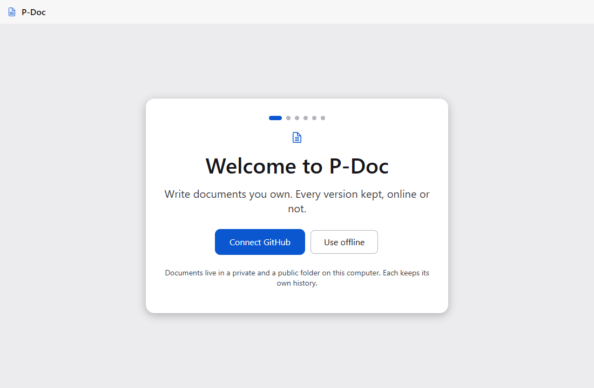

- **Git.** Skipped on its own when Git ≥ 2.40 is there; otherwise **Get Git** and **Check again**.
- **Sign in.** "Signed in as @login" straight away when Git's helper already has a GitHub sign-in. Otherwise **Sign in with browser** (shown only when Git Credential Manager or the GitHub CLI is installed; the CLI's one-time code is shown with **Cancel**) or **Paste a token**, a password field that checks the token with GitHub: "GitHub didn't accept this token. Check it and try again.", "This token can't create repositories. It needs the repo scope." With no credential helper at all, P-Doc keeps the sign-in until it closes and says so.

  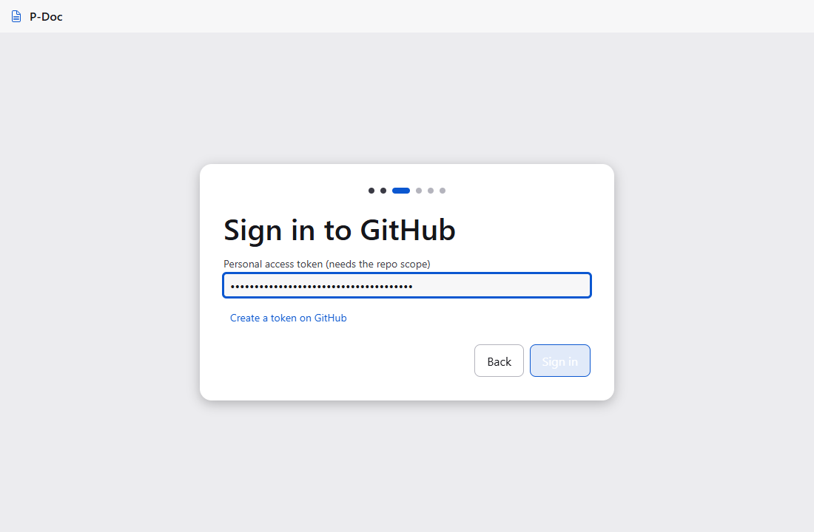 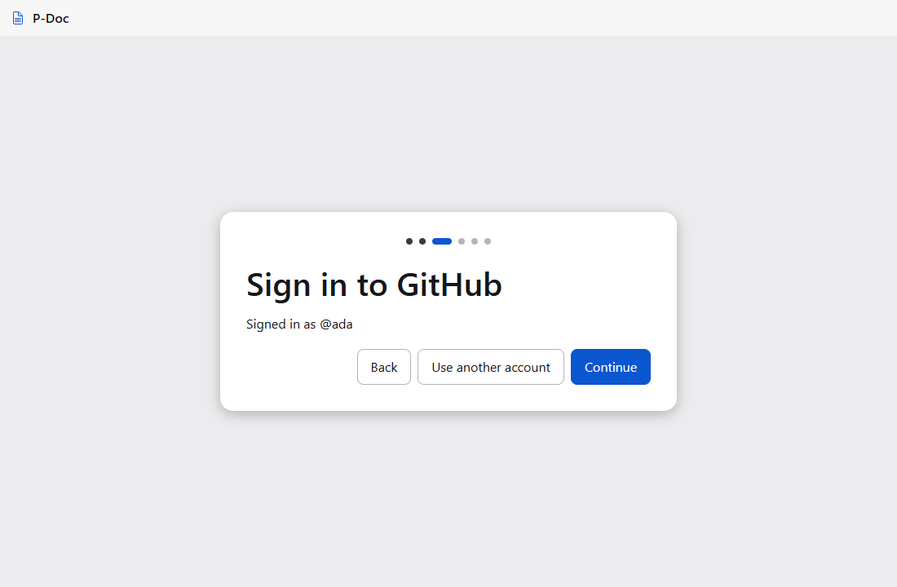

- **You.** Name and email for versions: Git's own name if set, else the GitHub account's; **Use my private GitHub address** fills the noreply address.

  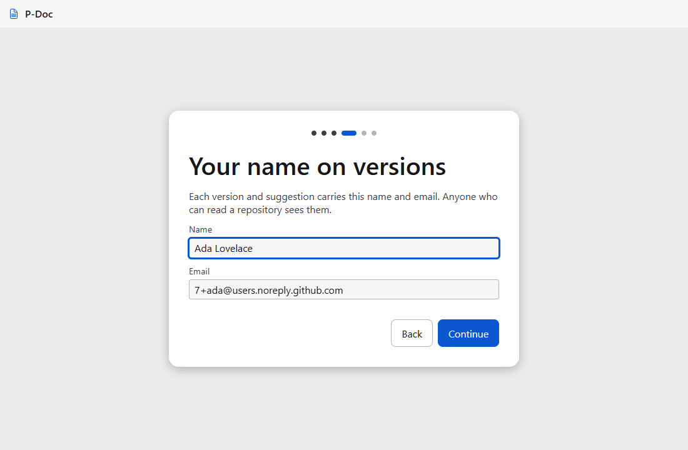

- **Repositories.** Both names editable, each with its Private/Public badge and state ("Will be created", "Found, will be used", "Already exists", "Ready"). A name taken by something that isn't a P-Doc library shows the problem with **Use it anyway** (its files are kept; P-Doc adds its `.p-doc` marker) and **Choose another name** (focuses the field). **Set up** shows each step as it runs.

  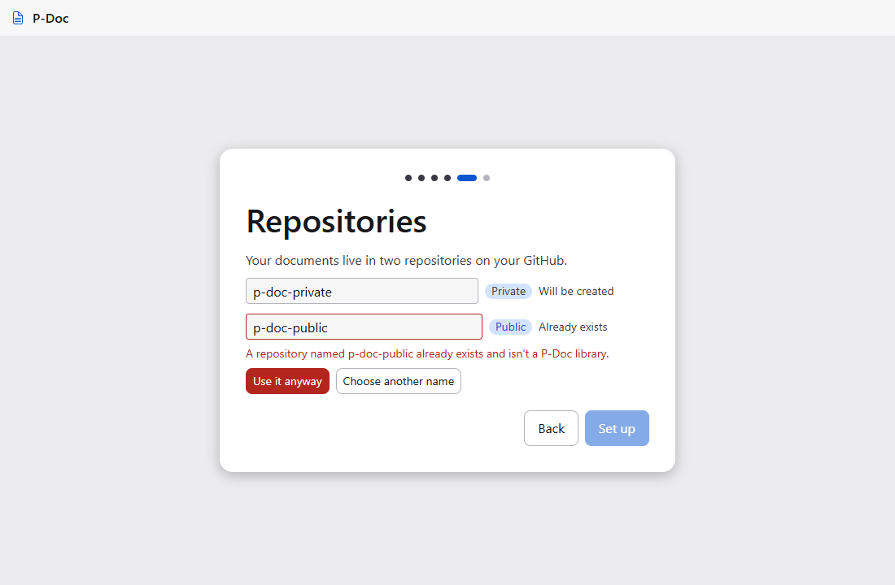 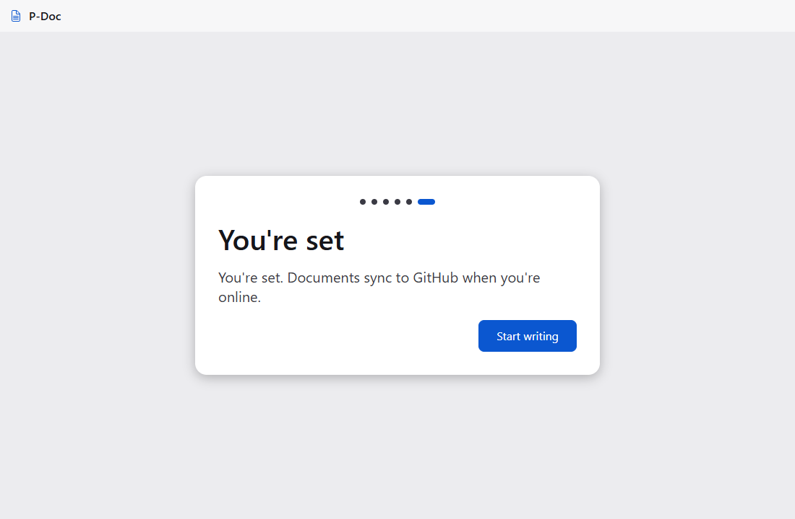

- **Syncing.** After each version (2 s later, so a burst syncs once), every 5 minutes, at start, and on **Sync now**. The title bar says "Saved · synced" when the open document's latest text is on GitHub, and "Saved to this computer" again after the next edit. When a sync brings in a change to the open document, the page shows it; if there are unsaved edits, they stay and the toast says the other text is in Version history.

  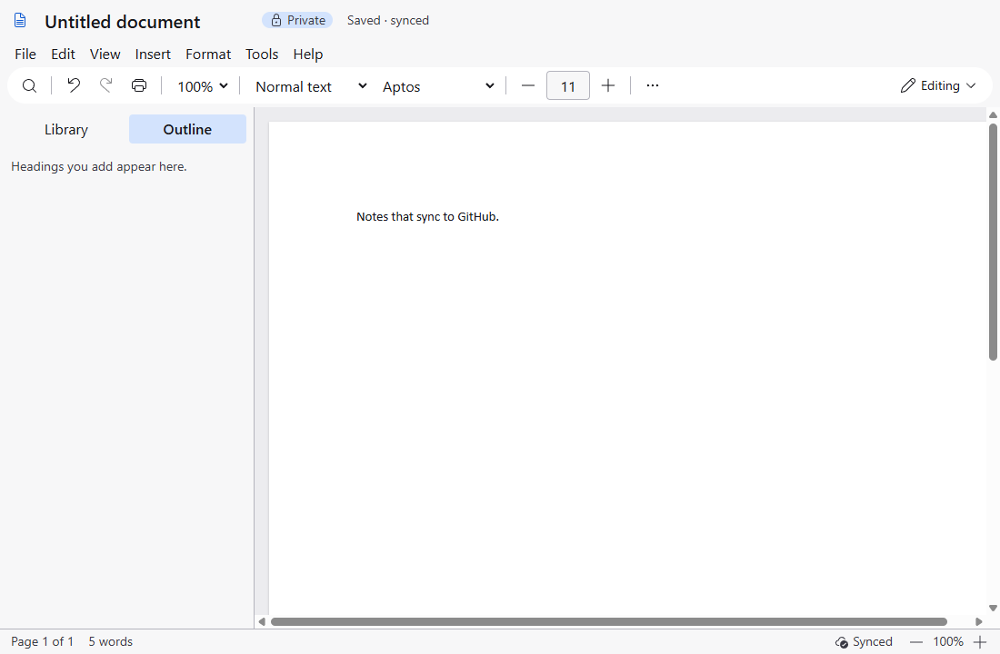

- **Settings > GitHub.** Account, both repositories (`login/name` with their badges), **Sync automatically**, the last sync, **Sync now** and **Sign out** (P-Doc stops syncing and forgets the session's sign-in; Git's helper, the repositories and the documents are untouched, and Settings offers **Connect GitHub** again). Not connected: **Connect GitHub**, or **Finish connecting** after a setup that stopped. **Sync problem** in the status bar opens a dialog with the reason, **Sign in again** when GitHub refused the sign-in, and the number of documents waiting.

  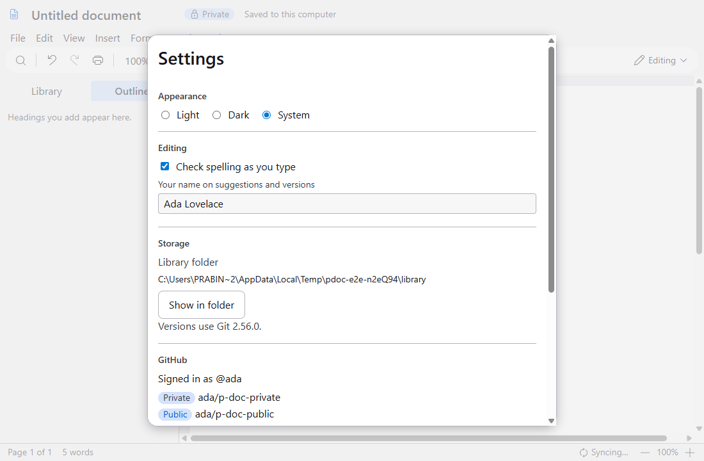

- **Privacy.** A Private document never reaches the public repository. **Move to Public** asks first; on the next sync it is in the public repository and gone from the private one's `main` (its earlier private history stays private).

Engineering notes:

- Main: `github.ts` (REST client: user, repo get and create, with offline, 401 and 404 told apart), `account.ts` (sign-in through Git's credential helper: `git credential fill/approve/reject`; GCM's window or `gh auth login --web` for the browser path; P-Doc stores no token), `setup.ts` (idempotent steps, `planProblem` shared with the renderer), `sync.ts` (`Sync`: fetch, merge `origin/main`, and when both sides edited a document keep this computer's file and add GitHub's as "*title* (from GitHub *date*)"; push; `pending` = versions not pushed plus saved edits not yet a version).
- `status()` reads the running state after its Git calls, so a status answer can't land after a run's final event and leave the window on "Syncing…". The menu bar re-renders on the sync state, so an open File menu enables **Sync now** when a sync ends.
- The renderer marks the open document pending on its first edit (main only reports at the next version or sync); that drives "Saved · synced" and the library's "Not synced yet".
- `PDOC_GITHUB_API` and `PDOC_GITHUB_REMOTE` point P-Doc at a fake GitHub (`test/fakes/fake-github.ts`: REST plus smart-HTTP Git over bare repositories, and a fake credential helper). Unit `github` (19 tests) covers account, setup and sync, including conflicts, auth failure and offline; e2e `github` covers 5.1–5.3 and 5.6 and checks the token is in none of P-Doc's data, the library or the log.
- Docs screenshots: `PDOC_CAPTURE=1 npx playwright test screens` (in `apps/desktop`) writes `docs/product/screens/`.
- `pnpm perf` adds "Sync (typing while it runs)": a key per frame in a 50-page document during 4 syncs to the fake GitHub, each pushing a version (budget 16 ms; p95 0.8 ms).
- Known limitations: offline during setup doesn't retry by itself (Settings > Finish connecting does); a version's name syncs, but removing one doesn't reach the other computer; a dirty open document keeps its edits over a change from GitHub (the change is in Version history).

### Stage 6: Import and export (built)

What a person meets, beyond the flows above:

- **File > Download.** Microsoft Word (.docx), PDF document (.pdf), Markdown (.md), Web page (.html) and Plain text (.txt). Each asks where to save (Downloads first) and says "Saved *name*" with **Show in folder**; a failure says "Couldn't export: *reason*" with **Try again**. Word keeps suggestions as Word's tracked changes; the other formats carry the text as it reads with every suggestion accepted.

  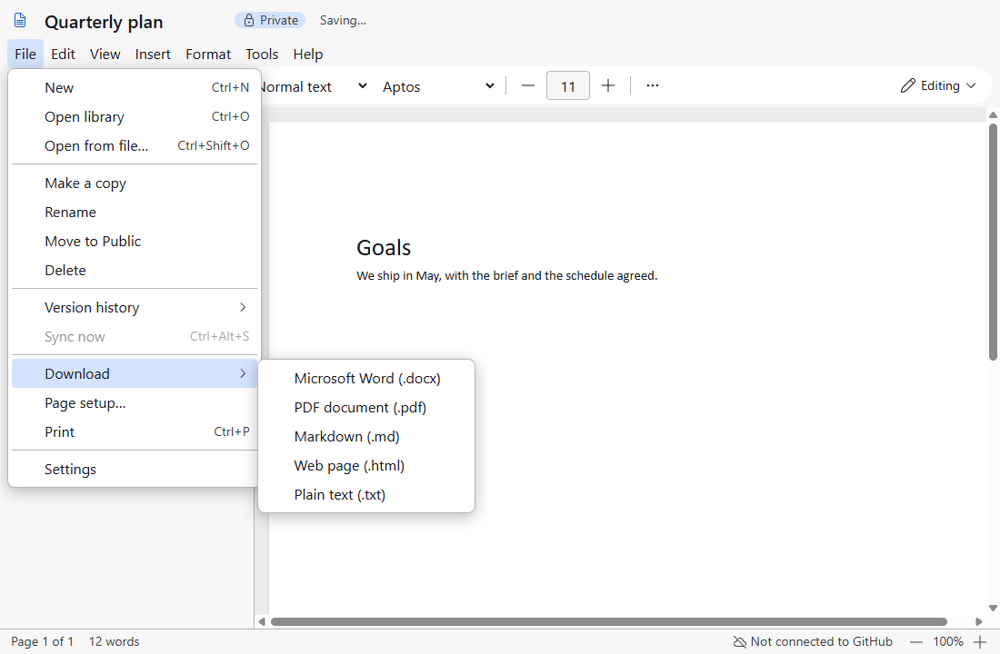

- **File > Open from file… (Ctrl+Shift+O)** and **a file dropped on the window.** A .docx, .md, .html, .txt or .pdoc.json becomes a new Private document titled from the file name, and opens: "Importing…" then "Opened *title*". Word parts P-Doc can't keep are named: "Imported. Some parts (text boxes, embedded objects) were left out." A .pdoc.json comes in whole with a new id, so it never replaces the document it was copied from. Images dropped on the page still go into the page; anything else is refused with "P-Doc can open .docx, .md, .html, .txt and .pdoc.json files." Files over 50 MB are refused before they are read.

  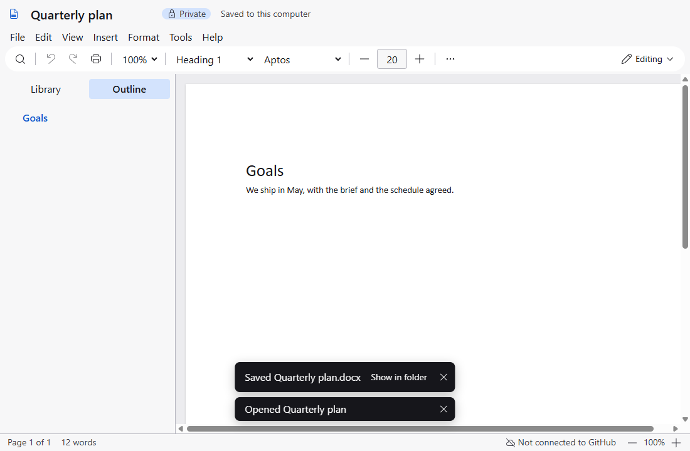

- **The `pdoc` command line** (U38), for scripts and agents, over the same library as the window: `pdoc setup --offline [--library <dir>]`, `new "Title" [--public]`, `list [--bin]`, `history <doc>`, `export <doc> --to docx|md|html|txt [--version <sha>] [--out <file>]` (text formats print when `--out` is left out), `import <file>`. A document is named by its id, its first 8 characters, its path or its title. `--json` prints one JSON value, errors included. Exit codes: 0 done, 1 usage, 2 no such document (or more than one: the matches are listed), 3 a person must act (`{"needs":"sign-in"}` from `setup` without `--offline`), 4 failed. In development it runs as `pnpm pdoc …`; the installed command comes with Install.

Engineering notes:

- `apps/desktop/src/main/files.ts` is Electron-free and shared by the window and the CLI: `exportBytes`, `readFile` (kind by extension, BOM stripped, 50 MB cap, mammoth warnings turned into the parts left out), and `importInto` (a new private document, or `Library.adopt` for a whole .pdoc.json).
- A dropped file's bytes travel to main (`output:importData`); its path never does. Open from file reads the path main itself chose in the dialog. `PDOC_OPEN_FILE` stands in for the dialog in tests (only with `PDOC_E2E`).
- Settings gained `library`: the library folder. The app records its default (Documents\P-Doc, wherever Documents points) on start, so the CLI finds the same folder when Documents is redirected; only `pdoc setup --library` changes it. The app's data folder is pinned to `%APPDATA%\P-Doc` (`PDOC_USER_DATA` for tests), the same in development and installed.
- Progress toasts ("Making PDF…", "Importing…") give way to their result instead of standing beside it.
- `pnpm perf` adds "Export .docx, 50 pages" (budget 3 s; p95 34 ms).
- A6 measured: embedded images make files and history too big (§9). Images move beside the document before the image features of the parity stages build on them.
- Known limitations: the packaged app has Electron's run-as-node fuse off, so the installed `pdoc` command is part of Install; the CLI and the window each queue their own commits, so a CLI command during a version commit can meet Git's index lock and fail with exit 4 (run it again).

### Stage 7: Images beside the document (built)

What a person meets, beyond the flows above:

- **Insert > Image…, a paste or a drop.** The picture is written to the repository's `assets/` folder under the SHA-256 of its bytes, then shown where the caret (or the drop) is, in line with text, centred, at its natural size up to the text width. Its file name becomes its first alt text. Over 20 MB: "This image is larger than 20 MB. Make it smaller and try again."; not a picture P-Doc can show: "This file isn't an image P-Doc can show. Use PNG, JPEG, GIF, WebP, SVG or BMP."
- **The image bar** (V11) over a selected picture: In line with text, Wrap left, Wrap right · Align left, centre, right (in line only) · Crop, Reset crop · Replace image…, Alt text…, Image options…. Corner handles resize (proportions kept; Shift frees them). Every action is also in command search (Alt+/). A picture drags to a new place with the mouse, keeping its settings.

  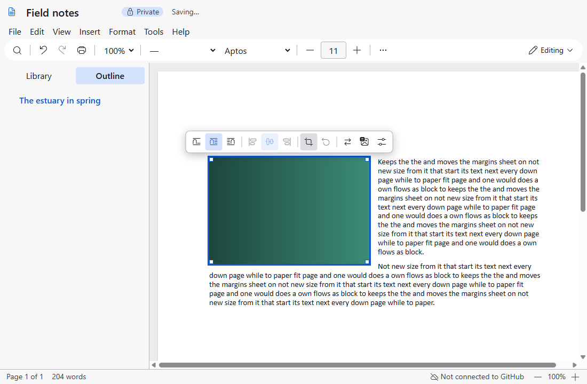

- **Crop** dims the whole picture and shows the kept part at full strength inside a frame with eight handles; the bar becomes **Keep crop** and **Cancel crop** (Enter and Esc). The stored file never changes.

  

- **Image options…** sets width and height in inches or centimetres (with Keep proportions) and the crop of each edge in per cent, for keyboard and exact work. **Alt text…** asks "Describe this image for people who can't see it."
- **Image missing.** A picture whose file is gone shows a dashed box with "Image missing"; the rest of the document works, and exports and print leave it out.
- **A newer P-Doc's document** opens with a banner, "Made with a newer P-Doc. Update to edit it.", shows the parts this build knows, and is never written.

Engineering notes:

- Format version 2 (`packages/core/src/image.ts`, `format.ts`): an image's `src` is `assets/<sha256>.<ext>`, relative to the repository root, with `width`, `height`, `align`, `wrap`, `crop` (fractions of each edge) and the natural size. Unknown image attributes survive a load and save. A version 1 document moves on its first editable open (`library:storeImages`): pictures first, then the document, then a version "Store images beside *title*". Every save stores any image still inside (`Library.write` → `storeImages`) and copies images used from the other repository, so the file on disk never names a missing picture.
- Main serves pictures to the window through the `pdoc-asset://a/<name>` scheme: `assets/` files only, read-only, from the document's repository first. Print and PDF inline them as data URLs (a transparent pixel where one is missing); .docx, HTML and `pdoc export` embed them; .docx import stores them beside the new document.
- Insert waits for main to write the picture (`assets:put`) before it puts it in the document, so the document never names a file that isn't there; a 20 MB picture is on the page in p95 143 ms, so the "show from memory first" step of §4.9 wasn't needed.
- The page content is block layout (`display: flow-root`), not a flex column, because floats do nothing in flex. Space before a paragraph is `padding-top` so it still adds to the space after the one above instead of collapsing into it.
- Pagination measures each block by position: its bottom less the end of the flow before it. A wrapped picture is recorded as a float that needs its height on the page; text beside it counts once. A guard stops the layout flapping between two answers when nothing was edited.
- The image NodeView mirrors the size, crop and natural size onto its element, because print and export clone the page's DOM. A missing picture hides the `img` itself so neither the broken-image icon nor the alt text shows.
- `pnpm perf` adds "Open a 100-page document with 20 images" (budget 500 ms; p95 87 ms) and "Insert a 20 MB image" (budget 300 ms; p95 143 ms). `PDOC_MEASURE=1` unit `a6-measure` now measures the stored form: a 0.7 MB file for 100 pages with 20 pictures of 2 MB, and 0.2 MB of Git for 10 more text-only versions.
- Known limitations: pictures are never deleted from `assets/`, even when no version uses them (P-Doc can't know every clone's history); wrap is square only (tight, through, behind and in front of text are Later in the parity audit).

### Stage 9: Paragraph layout (built)

What a person meets, beyond the flows above:

- **Format > Paragraph…** (V13) has four tabs: Indents and spacing, Line and page breaks, Borders and direction, Tabs. It shows the paragraph at the cursor and applies only the settings that were changed, to every paragraph in the selection. Lengths are in inches or centimetres by locale. Apply is one Undo step, and the cursor is back in the text.
- **Indents** use Word's meaning: Left is where the body lines start; First line pushes the first line in and Hanging pulls it out (into the margin if Left is 0, as Word allows).
- **Tabs.** Tab types a tab in a paragraph; it reaches the next stop or, past them, the next half inch. Right tabs end the text at the stop, centre tabs centre it, decimal tabs line up the first full stop. Leaders fill the gap with dots, dashes or a line.
- **View > Show ruler** (V13): the page's margins shaded, the paragraph's first line, hanging, left and right indents and its tab stops, measured from the margin. See §4.11 item 3. It follows the cursor into list items and table cells; while a document can't be typed in its markers stay where they are, and it's hidden while an older version is shown.

  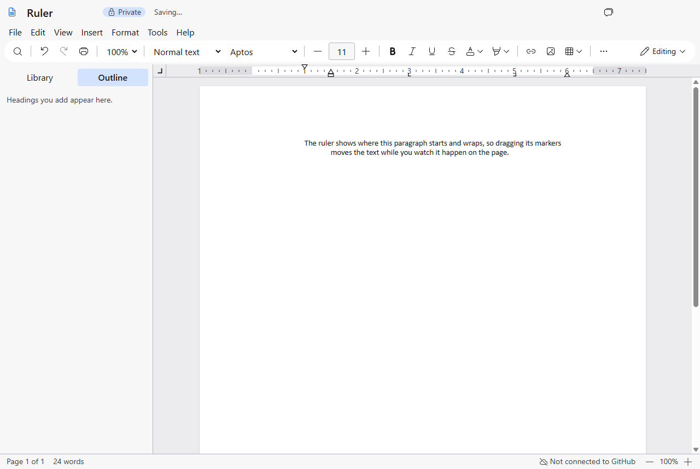

- **View > Show non-printing characters** (Ctrl+Shift+P): ¶, · for spaces (including at the end of a wrapped line), → for tabs (← in right-to-left paragraphs), ↵ for line breaks, and a labelled dashed line at a page break. Print, PDF and exports never carry them.

  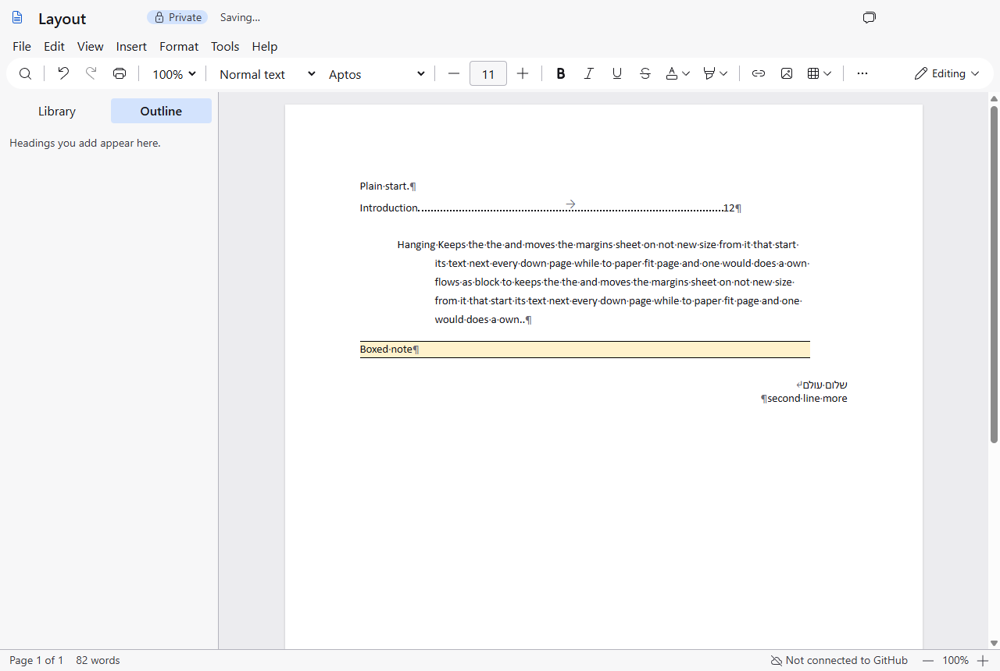

- **Line and page breaks.** Keep with next, Keep lines together, Page break before, and Widow and orphan control (on unless turned off for a paragraph). A paragraph splits across pages at a line, never leaving one line alone at a page's foot or head.
- **Borders and direction.** Top, bottom, left and right borders, a shading colour, and Left to right or Right to left.
- **Format > Sort…** sorts the selected paragraphs, the list the cursor is in, or a table's rows by a column (with a header row kept first), A to Z or Z to A; numbers sort as numbers and case doesn't change the order. Undo returns the old order in one step.
- **.docx** export writes the indents, spacing (exact, at least, multiple), keep rules, tabs with leaders, borders, shading and right-to-left as Word's own paragraph properties.

Engineering notes:

- Layout attributes live in one `layout` object per textblock (`packages/core/src/paragraph.ts`: `cleanLayout`, `patchLayout`, `layoutCss`); `indent` stays a half-inch count, and `indentPositions`/`indentFromPositions` convert to Word's Left and First/Hanging positions. A tab is an inline `tab` node rendered as `span.pd-tab` holding `\t`.
- Tab widths are set by `editor/tabs.ts` after each change, from the paragraph's own stops (`tabTo` in core); print copies the widths, so paper matches the screen.
- The keep rules are inputs to `paginate`: keep-with-next chains move with the block they keep with, a kept-together block moves whole when it fits a page, and the widow rule needs four lines to split.
- Non-printing marks: CSS for ¶, →, the page break label; decorations (`editor/marks.ts`) for spaces and line breaks, only while shown. Print strips the decoration classes and unwraps their spans.
- Dialogs return focus to the control that opened them unless that was the menu bar or the page itself, when the text gets it back. Sorting and every paragraph format are their own undo step (`closeHistory`).
- Not built in this stage: a paragraph context menu (there is no context menu yet; the commands are in Format, command search and the ruler).

### Stage 10: References (built; 10.3 in I10b)

What a person meets, beyond the flows above:

- **Insert > Footnote** (Ctrl+Alt+F) and **Insert > Endnote** (Ctrl+Alt+D). Notes number themselves in document order and renumber when one is deleted; a footnote sits at the foot of the page its number is on, and a long one goes on at the foot of the next page. **Convert to endnote** / **Convert to footnote** work on the note at the cursor; **Format > Notes…** sets the number formats and converts all. The PDF prints each page's notes once, as on screen.
- **Insert > Bookmark…** names the cursor's place from the next few words; the same dialog renames or removes the bookmark at the cursor. Its flag shows only with non-printing characters. **Ctrl+K** lists **Headings and bookmarks**; **Ctrl+click** on such a link goes to its place, or says the place is gone.
- **Insert > Contents options…** (when the document has a contents): **Levels** 1 to 1–6 and **Show** Page numbers (dotted leaders) or Links. Pageless always shows links. Clicking an entry goes to its heading.

Engineering notes:

- One anchor resolver (`packages/core/src/refs.ts`: `anchorsOf`, `anchorsOfJSON`) lists headings and bookmarks for links, Word export and, in I10b, cross-references. A bookmark is an inline atom with an `id` (`bm-…`) and a `name`; pasted duplicates get fresh ids (`syncHeadingsAndToc`).
- .docx: headings are wrapped in hidden `_pd_…` bookmarks, bookmarks keep sanitised unique names, `#` links are `w:hyperlink w:anchor`, and each contents entry is a link to its heading. No PAGEREF fields are written, so Word never asks to update fields; Word's own page numbers in the contents come when the owner updates it there. Import turns Word's heading bookmarks back into heading ids and drops hidden ones nothing links to.
- Page numbers settle (A19): `settlePages` repeats layout until two passes agree (at most 5) and `digitsFor` gives the widest number's digits; every number reserves that width (live as `--pd-toc-digits`), so a contents grows only when a number gains a digit. Page references in I10b must reserve the same way.
- Found on the way: closing a dialog opened from the page put the caret at the start, because the page was focused natively; dialogs now give focus back through the editor view.
- Not built in this stage: captions, cross-references and the table of figures (DoD 10.3, increment I10b, before stage 14).

### Stage 11: Sections and page layout (built; columns in I11b; 11.5 Later)

What a person meets, beyond the flows above:

- **Insert > Break ▸** Section break (next page, continuous, odd page, even page) and Column break (Ctrl+Shift+Enter). An odd or even section that lands on the wrong page gets a blank page before it, on screen and in the PDF.
- **File > Page setup** opens on the cursor's section with **Apply to** This section or Whole document: orientation, paper and margins per section, one Undo step. Each sheet is drawn and printed on its section's paper; Pageless shows one flow and keeps every section setting.
- **Insert > Header and footer** shows "Section k of n": **Link to previous** (on by default; linked text shows read-only), **Different odd and even pages** with even header and footer, and **Page numbers**: format 1, i, I, a, A, and Continue or **Start at**.
- **Insert > Watermark…**: words in a light colour (Grey, Red, Blue, Green), Diagonal or Horizontal, behind every page including blank ones, and in the PDF; **Insert > Remove watermark**.

Engineering notes:

- A section is the run of blocks up to a `sectionBreak` atom, which carries that section's `kind`, and its own `page` geometry, `hf` texts, `numbering` and `columns` as JSON `data-*` attributes; the first section's are the document's page setup. `sectionsOf` resolves them, inheriting from the section before; `pageFaces` gives every page (blank ones too) its number, label, header and footer.
- Layout: `paginate` takes a section's page height and start (`BlockBox.section`), adds blank pages for odd and even starts, and the live page area keeps the first section's padding, shifting other sections' text with `.pd-sec-shift`. Print writes one named `@page` per paper size.
- .docx: one Word section per section (`w:sectPr` with type, size, orientation, margins, `pgNumType`, `w:cols`), headers only where a section is unlinked, `w:evenAndOddHeaders`; a column break is `w:br w:type="column"`. Not yet: reading sections back from an imported .docx, and watermarks in .docx.
- Performance: repagination of a 57-page document of 13 sections p95 9.1 ms (budget 16).
- Not built in this stage: columns laid out on screen and in the PDF, balancing and **Format > Columns…** (DoD 11.2, increment I11b, after I10b); picture watermarks; line numbers, hyphenation and drop caps (DoD 11.5, Later).

### Stage 12: Tables, code and equations (built; 12.1 in part; 12.5 waits on the owner)

What a person meets, beyond the flows above:

- **Format > Table ▸** Merge cells, Split cell, Header row (checked when on), Distribute columns, **Cell shading ▸** (light colours or None), **Vertical alignment ▸** Top, Middle, Bottom, and **Table properties…**: column width in inches, cell padding in points, and a border width and colour for the selected cells. Column edges can be dragged. Each change is one Undo step.
- Long tables break between rows on screen and in the PDF; a header row repeats at the top of each page it continues on, read-only there.
- **Code blocks:** ```` ```js ```` and a space, or the Code paragraph style, starts one; it colours as you type, and a picker at its top right sets the language (Automatic guesses, Plain text never colours). The picker is hidden in print and off in Viewing.
- **Equations:** **Insert > Equation…** or **Alt+=** opens a LaTeX field with a live preview and a readable error; `$…$` typed in a paragraph becomes an inline equation; on an empty line it is a centred display equation. A click opens it again.

Engineering notes:

- Tables: TipTap's TableKit with `resizable`; cell attributes `background`, `valign`, `borderWidth`, `borderColor`, `padding` (`data-*` plus inline style, colours read as hex from `rgb()` or `#rgb`). Word gets a fixed grid (`w:gridCol`, `w:tcW` in twips) when every first-row cell has a width and 100 % otherwise, with `w:shd`, `w:vAlign`, `w:tcBorders`, `w:tcMar` and `w:tblHeader`.
- Long tables: `paginate` places table rows as blocks of their own (a row spanning the next is kept with it), and the live view draws a copy of the header row at the top of each continued page.
- Code: lowlight (MIT) with highlight.js (BSD-3) as ProseMirror decorations coloured by the `color.code-*` tokens; the language is the block's attribute, kept in Markdown and HTML. Not yet: colours in Word (Consolas, uncoloured).
- Equations: KaTeX (MIT) draws; LaTeX is what the file keeps; OMML for Word comes from docx's own `latexToMath`, MathML for HTML from KaTeX, `$…$` and `$$…$$` for Markdown.
- Not built in this stage: table alignment on the page, text to table and back (DoD 12.1, Later); a row taller than a page breaking inside it (12.2, Later).

### Stage 13: Review power

- **Suggestions:** emphasis and paragraph style/alignment changes in Suggesting are "Formatted: …" cards. Reject restores the exact old marks, block type and attributes; Accept keeps the new ones. Each decision is one Undo step.
- **Commenting** in the toolbar and View > Mode prevents text changes and formatting while comments still work. **Tools > Review > Always suggest in this document** persists in the file; reopening enters Suggesting. Choosing Editing asks to turn it off; existing suggestions are kept.
- **Reviewers:** the panel's Everyone menu filters suggestions by exact author name. Comments remain visible. Bulk decisions and next/previous navigation use the shown list, including the Open/Resolved choice; a filtered bulk button says "Accept 4 shown". This is a panel filter, not a way of hiding markup on the page.
- **Compare documents:** Tools reads the original and revised documents from the library, the open document or a file without importing that file. A new private comparison opens in All markup. Words are paired within alike blocks; unlike blocks are removed or added whole. Accept all equals the revised content and Reject all the original, including formatting. Comparing two 51-page documents through saving and drawing took p95 844 ms (budget 1 s); a 111-row split table repaginates in p95 2.3 ms (16 ms budget).
- **Word review:** comments with replies and resolved state, insertions/deletions and run/paragraph formatting revisions import and export with author and time. Moves and table revisions import applied as Word shows them and are described in comments, with a kept-as-comments count. Old run formatting reads bold, italic, strike, superscript and subscript; old paragraph formatting reads style and alignment. Other old formatting properties are not yet represented.
- **Known comparison limits:** revised comment threads are not copied into a comparison. Whole-block comparison suggestions are kept in P-Doc; Word export explicitly asks to accept or reject them first, rather than silently exporting a deleted block as ordinary text. Their tracked representation in Word is not yet implemented.
