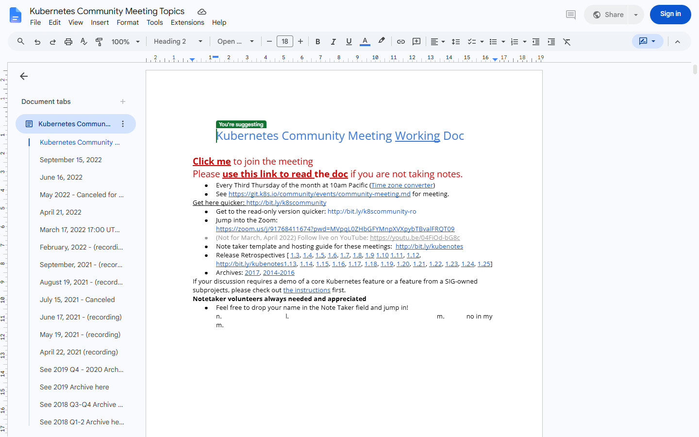

# Research

P-Doc's spec is grounded in two reverse-engineering knowledge bases made with the RES method. Google Docs was observed live with a Stagehand rig on a public document; Word was studied from Microsoft's help pages.

| Product | Method | Features | Rules | Flows | Evidence | Full report |
|---|---|---|---|---|---|---|
| Google Docs | Stagehand capture of a public document (anonymous, no clicks) + 12 help pages | 42 | 10 | 4 | EV-001 screenshot, EV-002 DOM inventory and design tokens, EV-003 menu tree | <a href="research/google-docs-report.html" target="_blank" rel="noopener">Open report</a> |
| Microsoft Word | 13 help pages | 30 | 10 | 3 | Documentation only | <a href="research/microsoft-word-report.html" target="_blank" rel="noopener">Open report</a> |

## What P-Doc takes

| From | What | Why | Spec |
|---|---|---|---|
| Google Docs | Autosave with a save state next to the title; Ctrl+S harmless | No Save step, no lost work | U1 |
| Google Docs | One calm pill toolbar; shortcut in every button name; menu search (Alt+/) | Easy to scan, teaches keys | V2, U11 |
| Google Docs | Editing / Suggesting / Viewing as one mode switch | Review without a separate tool | U21 |
| Google Docs | Pages and Pageless with text width | Draft wide, print true | U13 |
| Google Docs | Version history panel: grouped, named versions, restore keeps history | Find any state again | U28–U31 |
| Word | Navigation pane: drag a heading to move its section | Restructure without cut and paste | U8 |
| Word | Markup views (Simple, All, No markup, Original), accept/reject and move to next, reviewing pane | Fast, clear review | U23, U24, U26 |
| Word | Styles with "Update to match selection" | Consistent documents | U4 |
| Word | Find and replace with match case, whole words, patterns | Power editing | U10 |
| Word | Headers and footers with different first page; page numbers | Real deliverables | U15 |
| Both, improved | Table of contents that updates itself (both need a manual refresh) | Never stale | U9 |
| Neither | Files you own in your Git repositories, private and public, offline first | Ownership and history | P2, P6 |

## What P-Doc leaves out

- Real-time co-editing, sharing roles, publish to web (they need a hosted service).
- Google- and Microsoft-only services: smart chips to Drive people, Explore, translate, voice typing, mail merge, add-ins.

## Gaps

- Signed-in Google Docs surfaces (comment cards, suggestion review, version history UI) and all of Word's visuals were not observed live; they need test accounts.
